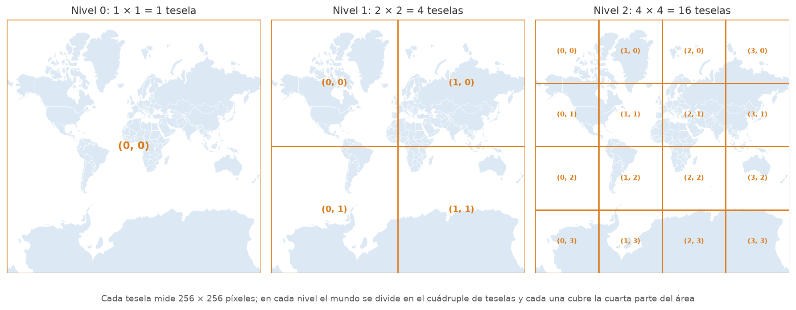

## Trabajo previo

### Lecturas

Antes de la clase, revise las siguientes lecturas. La sección de mapas interactivos de *Geocomputation with R* presenta, en pocas páginas, los mapas web con leaflet y con otros paquetes que se apoyan en él; la introducción de la documentación de leaflet para R recorre lo que hace este capítulo: crear un mapa, cambiar el mapa base, agregar marcadores y capas vectoriales.

Lovelace, R., Nowosad, J., y Münchow, J. (2025). Interactive maps. En *Geocomputation with R* (2.ª ed., sección 9.4). Chapman and Hall/CRC. <https://r.geocompx.org/adv-map#interactive-maps>

Cheng, J., Schloerke, B., Karambelkar, B., y Xie, Y. (s. f.). Introduction. En *Leaflet for R*. Recuperado el 29 de octubre de 2026, de <https://rstudio.github.io/leaflet/articles/leaflet.html>

### Otros recursos

Instale los dos paquetes del capítulo antes de la clase: `install.packages(c("leaflet", "leaflet.extras"))`. La [documentación de leaflet para R](https://rstudio.github.io/leaflet/) es la referencia del capítulo: en particular, las páginas sobre [mapas base](https://rstudio.github.io/leaflet/articles/basemaps.html), [marcadores](https://rstudio.github.io/leaflet/articles/markers.html), [ventanas emergentes y etiquetas](https://rstudio.github.io/leaflet/articles/popups.html), [polígonos](https://rstudio.github.io/leaflet/articles/shapes.html), [colores](https://rstudio.github.io/leaflet/articles/colors.html), [leyendas](https://rstudio.github.io/leaflet/articles/legends.html) y [control de capas](https://rstudio.github.io/leaflet/articles/showhide.html). La [documentación de Leaflet](https://leafletjs.com/reference.html), la biblioteca de JavaScript que el paquete usa por debajo, explica el significado de cada opción. La [vista previa de proveedores de teselas](https://leaflet-extras.github.io/leaflet-providers/preview/) muestra los mapas base disponibles y sus condiciones de uso, y la [política de uso de teselas de OpenStreetMap](https://operations.osmfoundation.org/policies/tiles/) dice lo que se puede y no se puede hacer con el mapa base gratuito más usado.

## Introducción

Los mapas de los dos capítulos anteriores fueron **estáticos**: imágenes producidas por ggplot2, con una extensión, una escala y una simbología fijadas por quien las hizo. Un **mapa web** es distinto: se muestra en el navegador, y quien lo consulta decide hacia dónde desplazarse, cuánto acercarse y qué capas ver, y obtiene información al pasar el cursor o hacer clic sobre cada entidad. Es la forma en que se publican hoy los mapas en Internet, desde los visores de los institutos geográficos hasta las aplicaciones de transporte, y es el componente geoespacial de la aplicación shiny que se desarrollará en la sección V del curso.

[leaflet](https://rstudio.github.io/leaflet/) es el paquete de R para crear mapas web. Por sí mismo no dibuja nada: genera una página HTML con código de [Leaflet](https://leafletjs.com/), la biblioteca de JavaScript de código abierto en que se basan buena parte de los mapas web, y el navegador la ejecuta. Es un **htmlwidget**, como plotly y DT en el [capítulo 13](../iii-tidyverse/13-plotly-dt.qmd): los datos se preparan en R, con sf y dplyr, y la interactividad corre en el navegador; en un documento Quarto, el mapa se inserta como un gráfico más. La sintaxis también es conocida: se crea el mapa con `leaflet()` y se le agregan, con el *pipe*, el mapa base, las capas y los controles, cada uno con una función `add…()`, como se agregan capas a un gráfico de ggplot2 con `+`.

Los datos son los del [capítulo anterior](16-sf-operaciones-espaciales.qmd): los cantones y las provincias del IGN y los registros de presencia de félidos de GBIF. Y hay una regla nueva, que vale para todos los mapas web: **leaflet recibe coordenadas geográficas, en WGS84**. Las operaciones espaciales se hacen en CRTM05, en metros; el mapa web se dibuja en grados. Una capa en otro SRC no produce un error, sino un mapa vacío (la clínica de errores lo muestra).

```{r}
#| label: preparacion
#| message: false
library(tidyverse)
library(sf)
library(leaflet)
library(leaflet.extras)

# Directorio de datos en el repositorio del curso
datos <- "https://raw.githubusercontent.com/pf0953-programacionr/2026-ii/main/datos/"
```

## Carga de las capas

Las capas se leen y se preparan como en el capítulo anterior: los félidos se convierten en puntos con `st_as_sf()`, se reproyectan a CRTM05 y se cuentan por cantón con `st_join()`, de modo que `cantones` tenga las columnas `registros` y `registros_100km2`. Todo eso ocurre en metros:

```{r}
#| label: carga
#| message: false
cantones <- st_read(paste0(datos, "cantones.gpkg"), quiet = TRUE)
provincias <- st_read(paste0(datos, "provincias.gpkg"), quiet = TRUE)

felidos <- read_csv(paste0(datos, "felidos.csv")) |>
  st_as_sf(coords = c("decimalLongitude", "decimalLatitude"), crs = 4326) |>
  st_transform(8908)

registros_canton <- felidos |>
  st_join(cantones, join = st_within) |>
  st_drop_geometry() |>
  count(codigo_canton, name = "registros")

cantones <- cantones |>
  left_join(registros_canton, by = "codigo_canton") |>
  mutate(
    registros = replace_na(registros, 0),
    area_km2 = as.numeric(st_area(geom)) / 1e6,
    registros_100km2 = registros / area_km2 * 100
  )
```

Y, terminadas las operaciones, las tres capas se reproyectan a WGS84 (EPSG:4326) para el mapa web. Es el patrón del capítulo: **medir en CRTM05, dibujar en WGS84**.

```{r}
#| label: st-transform
cantones <- st_transform(cantones, 4326)
provincias <- st_transform(provincias, 4326)
felidos <- st_transform(felidos, 4326)

st_bbox(cantones)
```

La extensión está ahora en grados: de 87° O (la Isla del Coco) a 82,5° O y de 5,5° N a 11,2° N.

## Un primer mapa

[`leaflet()`](https://rstudio.github.io/leaflet/reference/leaflet.html) crea el mapa, [`addTiles()`](https://rstudio.github.io/leaflet/reference/addProviderTiles.html) le agrega el mapa base predeterminado, OpenStreetMap, y [`setView()`](https://rstudio.github.io/leaflet/reference/map-methods.html) fija el centro inicial, con la longitud y la latitud **nombradas** (`lng` y `lat`, lo que evita confundir el orden), y el **nivel de acercamiento** inicial (`zoom`). El mapa se puede desplazar con el ratón y acercar con la rueda o con los botones:

```{r}
#| label: primer-mapa
#| fig-height: 5
leaflet() |>
  addTiles() |>
  setView(lng = -84.2, lat = 9.9, zoom = 7)
```

Lo que Quarto muestra es una página web incrustada. Como todo htmlwidget, el mapa es un objeto de R que puede guardarse con `<-` y completarse después, y que se dibuja al imprimirse. Dos detalles de Quarto, los mismos que con plotly: `fig-height` fija el alto (el ancho es siempre el disponible en la página) y una etiqueta `fig-` con `fig-cap` numera el mapa como figura.

### Teselas y niveles de acercamiento

El fondo del mapa es el **mapa base**, y no es una imagen única sino un mosaico de **teselas** (*tiles*): imágenes cuadradas de 256 píxeles que un servidor tiene precalculadas para cada nivel de acercamiento. En el nivel 0, una sola tesela contiene el mundo entero; en cada nivel siguiente, cada tesela se divide en cuatro, de modo que el nivel $z$ tiene $4^z$ teselas (figura 1). El navegador descarga solo las teselas visibles en pantalla y pide otras al desplazarse o acercarse: así un mapa del mundo con detalle de calles cabe en una página web.

<figure style="text-align: center;">
  
  <figcaption><strong>Figura 1</strong>. La pirámide de teselas de un mapa web: en el nivel 0 una tesela cubre el mundo; en cada nivel siguiente, cada tesela se divide en cuatro. Las teselas se identifican por su nivel y sus índices (x, y), contados desde la esquina superior izquierda. Fuente: elaboración propia con datos de Natural Earth (s. f.).</figcaption>
</figure>

Las teselas están en la proyección [Web Mercator](https://es.wikipedia.org/wiki/Proyecci%C3%B3n_Web_Mercator) (EPSG:3857), que convierte el mundo en un cuadrado: por eso el mapa web muestra una Groenlandia enorme, como se vio en el [capítulo 15](15-sf-datos-vectoriales.qmd), y por eso excluye las latitudes por encima de 85°. Cada tesela se identifica por su nivel $z$ y sus índices $x$ y $y$, y su dirección en el servidor sigue el patrón `{z}/{x}/{y}.png`. Con la fórmula de la proyección se calcula a qué tesela pertenece un punto en cada nivel:

```{r}
#| label: tesela
# Índices (x, y) de la tesela que contiene un punto, en un nivel de acercamiento dado
tesela <- function(lat, lng, nivel) {
  n <- 2^nivel
  x <- floor((lng + 180) / 360 * n)
  lat_rad <- lat * pi / 180
  y <- floor((1 - log(tan(lat_rad) + 1 / cos(lat_rad)) / pi) / 2 * n)
  c(x = x, y = y)
}

# El centro de San José en cuatro niveles
for (nivel in c(0, 5, 10, 15)) {
  cat("Nivel", nivel, ": tesela", tesela(9.93, -84.08, nivel), "de", 4^nivel, "\n")
}
```

La tesela del nivel 10 que contiene el centro de San José se puede pedir directamente al servidor de OpenStreetMap, como la imagen PNG que es: <https://tile.openstreetmap.org/10/272/483.png>. Un mapa web es, entonces, una pila: las teselas del mapa base abajo, las capas con los datos propios encima, y los controles. Lo que sigue recorre la pila de abajo hacia arriba.

*Ejercicios de esta sección: [ejercicios sobre mapas base](#ejercicios-mapas-base).*

## Mapas base

[`addProviderTiles()`](https://rstudio.github.io/leaflet/reference/addProviderTiles.html) agrega un mapa base del catálogo de [leaflet-providers](https://leaflet-extras.github.io/leaflet-providers/preview/), más de 200 proveedores de teselas, con el nombre en la lista `providers` (RStudio lo autocompleta al escribir `providers$`): `providers$OpenTopoMap` (relieve y curvas de nivel) o `providers$Esri.WorldImagery` (imágenes de satélite):

```{r}
#| label: opentopomap
#| fig-height: 5
leaflet() |>
  addProviderTiles(providers$OpenTopoMap) |>
  setView(lng = -84.2, lat = 9.9, zoom = 7)
```

Varios mapas base pueden convivir en el mismo mapa: cada uno se agrega con un nombre de **grupo** (`group`), y [`addLayersControl()`](https://rstudio.github.io/leaflet/reference/addLayersControl.html) añade el **control de capas**, el ícono de la esquina superior derecha que permite elegir el mapa base (`baseGroups`, uno a la vez) y mostrar u ocultar las demás capas (`overlayGroups`, que se verán más adelante). [`addScaleBar()`](https://rstudio.github.io/leaflet/reference/addScaleBar.html) agrega la barra de escala. Este patrón —crear el mapa, agregarle elementos con el *pipe* y terminar con el control de capas— es el de todo el capítulo:

```{r}
#| label: mapas-base
#| fig-height: 5
leaflet() |>
  addTiles(group = "OpenStreetMap") |>
  addProviderTiles(providers$OpenTopoMap, group = "Topográfico (OpenTopoMap)") |>
  addProviderTiles(providers$Esri.WorldImagery, group = "Imágenes de satélite (Esri)") |>
  addProviderTiles(providers$Esri.WorldGrayCanvas, group = "Fondo gris (Esri)") |>
  setView(lng = -84.2, lat = 9.9, zoom = 7) |>
  addLayersControl(
    baseGroups = c("OpenStreetMap", "Topográfico (OpenTopoMap)", "Imágenes de satélite (Esri)", "Fondo gris (Esri)"),
    options = layersControlOptions(collapsed = FALSE)
  ) |>
  addScaleBar(position = "bottomleft")
```

Cualquier otro servidor de teselas se agrega con `addTiles()`, su patrón de dirección y la **atribución** obligatoria (`attribution`), el texto de la esquina inferior derecha que reconoce al autor de los datos; leaflet la rellena sola para los proveedores del catálogo y hay que escribirla para los demás. La versión humanitaria de OpenStreetMap, por su dirección:

```{r}
#| label: addtiles-url
#| fig-height: 5
leaflet() |>
  addTiles(
    urlTemplate = "https://{s}.tile.openstreetmap.fr/hot/{z}/{x}/{y}.png",
    attribution = '&copy; <a href="https://www.openstreetmap.org/copyright">OpenStreetMap</a> contributors, estilo del <a href="https://www.hotosm.org/">Humanitarian OpenStreetMap Team</a>'
  ) |>
  setView(lng = -84.2, lat = 9.9, zoom = 7)
```

La tabla 1 resume los mapas base de uso libre más útiles. Dos advertencias. Los mapas base de CARTO (`providers$CartoDB.Positron`, `providers$CartoDB.DarkMatter`), muy usados en ejemplos y en documentación, exigen desde 2026 una clave de API, y sin ella aparecen con la marca "API KEY REQUIRED": no conviene usarlos. Y OpenStreetMap sirve sus teselas gratis para usos moderados, como un documento, un sitio en GitHub Pages o la aplicación del proyecto final, pero su política de uso prohíbe el uso masivo; una aplicación con muchos usuarios necesita un proveedor propio.

<figure style="text-align: center; margin: 20px 0;">
    <figcaption><strong>Tabla 1</strong>. Mapas base de uso libre en leaflet, por el nombre con que se piden en <code>providers</code>. Fuente: elaboración propia con base en Leaflet-extras (s. f.) y en las condiciones de cada proveedor.</figcaption>
    <table class="table table-bordered table-striped" style="margin: 0 auto;">
    <thead>
      <tr><th>Nombre</th><th>Contenido</th><th>Uso típico</th></tr>
    </thead>
    <tbody>
      <tr><td><code>OpenStreetMap</code> (o <code>addTiles()</code>)</td><td>Calles, lugares y topónimos del mapa colaborativo</td><td>Mapa base general; el predeterminado</td></tr>
      <tr><td><code>OpenTopoMap</code></td><td>Relieve sombreado y curvas de nivel sobre OpenStreetMap</td><td>Temas físicos: altitud, cuencas, rutas</td></tr>
      <tr><td><code>Esri.WorldImagery</code></td><td>Mosaico de imágenes de satélite y aéreas</td><td>Cobertura de la tierra, verificación visual</td></tr>
      <tr><td><code>Esri.WorldTopoMap</code></td><td>Mapa topográfico con relieve y topónimos</td><td>Mapas de referencia</td></tr>
      <tr><td><code>Esri.WorldGrayCanvas</code></td><td>Fondo gris claro con pocos rótulos</td><td>Coropletas y capas temáticas que deben destacar</td></tr>
      <tr><td><code>OpenStreetMap.HOT</code></td><td>Estilo humanitario de OpenStreetMap</td><td>Infraestructura y servicios</td></tr>
      <tr><td><code>NASAGIBS.ViirsEarthAtNight2012</code></td><td>Luces nocturnas (NASA)</td><td>Asentamientos y actividad económica</td></tr>
    </tbody>
    </table>
</figure>

*Ejercicios de esta sección: [ejercicios sobre mapas base](#ejercicios-mapas-base).*

## Marcadores y ventanas emergentes

[`addMarkers()`](https://rstudio.github.io/leaflet/reference/map-layers.html) coloca un **marcador** en una ubicación `lng`, `lat`. Su `label` es la **etiqueta emergente** que aparece al pasar el cursor; su `popup`, la **ventana emergente** que se abre al hacer clic, y que admite HTML (negritas, saltos de línea, enlaces, imágenes). Tres lugares del centro de San José, con un vector de longitudes, uno de latitudes y uno de etiquetas:

```{r}
#| label: addmarkers
#| fig-height: 5
leaflet() |>
  addTiles() |>
  addMarkers(
    lng = c(-84.0770, -84.0717, -84.0820),
    lat = c(9.9332, 9.9328, 9.9347),
    label = c("Teatro Nacional", "Museo Nacional", "Mercado Central"),
    popup = c(
      "<b>Teatro Nacional de Costa Rica</b><br>Inaugurado en 1897",
      '<b>Museo Nacional de Costa Rica</b><br><a href="https://www.museocostarica.go.cr/" target="_blank">Sitio web</a>',
      "<b>Mercado Central</b><br>Fundado en 1880"
    )
  )
```

Sin `setView()`, el mapa se ajusta a las capas que contiene. Para muchos puntos, el marcador con ícono resulta pesado. [`addCircleMarkers()`](https://rstudio.github.io/leaflet/reference/map-layers.html) dibuja un círculo de radio fijo **en píxeles** (no cambia de tamaño al acercarse) y admite `color`, `fillColor` y `fillOpacity`, como los puntos de ggplot2; [`addCircles()`](https://rstudio.github.io/leaflet/reference/map-layers.html) dibuja un círculo con radio **en metros**, que sí escala con el mapa: la diferencia se ve al acercarse y alejarse. Un marcador de cada tipo alrededor de la Escuela de Geografía:

```{r}
#| label: circulos
#| fig-height: 5
leaflet() |>
  addTiles() |>
  setView(lng = -84.0512, lat = 9.9377, zoom = 15) |>
  addCircleMarkers(lng = -84.0512, lat = 9.9377, radius = 8, color = "#eb6834", fillOpacity = 0.8, label = "addCircleMarkers(): 8 píxeles") |>
  addCircles(lng = -84.0512, lat = 9.9377, radius = 500, color = "#005da4", fillOpacity = 0.1, label = "addCircles(): 500 m")
```

### Puntos de una capa

Con una capa de puntos, los marcadores se toman de los datos: el argumento `data` recibe el objeto sf (en WGS84), y los demás argumentos pueden referirse a sus columnas con una **fórmula**, `~columna`, la misma notación con que `aes()` mapea estéticas en ggplot2. [`colorFactor()`](https://rstudio.github.io/leaflet/reference/colorNumeric.html) construye una función que asigna un color a cada categoría, y [`addLegend()`](https://rstudio.github.io/leaflet/reference/addLegend.html) la muestra como leyenda. Los 1 041 registros de félidos, con la especie en el color y en la etiqueta, y la ventana emergente construida con `paste0()`:

```{r}
#| label: puntos-capa
#| fig-height: 6
paleta_especies <- colorFactor(palette = "Dark2", domain = felidos$species)

leaflet(felidos) |>
  addProviderTiles(providers$Esri.WorldGrayCanvas) |>
  addCircleMarkers(
    radius = 4,
    color = ~paleta_especies(species),
    fillOpacity = 0.7,
    stroke = FALSE,
    label = ~species,
    popup = ~paste0(
      "<b>", species, "</b><br>",
      "Fecha: ", eventDate, "<br>",
      "Localidad: ", locality
    )
  ) |>
  addLegend(position = "bottomright", pal = paleta_especies, values = ~species, title = "Especie")
```

Los datos pueden darse a `leaflet()` (y los heredan todas las capas) o a cada función `add…()` con `data =`, como en ggplot2. Cuando los puntos son cientos o miles, se **agrupan**: `clusterOptions = markerClusterOptions()` reúne los marcadores cercanos en un círculo con el número de puntos, que se despliega al acercarse. El agrupamiento es visual, depende del nivel de acercamiento y no distingue categorías: cuenta registros en la vecindad, sin importar la especie.

```{r}
#| label: cluster
#| fig-height: 6
leaflet(felidos) |>
  addTiles() |>
  addMarkers(
    label = ~species,
    popup = ~paste0("<b>", species, "</b><br>", eventDate),
    clusterOptions = markerClusterOptions()
  )
```

*Ejercicios de esta sección: [ejercicios sobre marcadores](#ejercicios-marcadores).*

## Capas vectoriales

Los polígonos se agregan con [`addPolygons()`](https://rstudio.github.io/leaflet/reference/map-layers.html) y las líneas con `addPolylines()`, con los mismos argumentos: `color` y `weight` para el borde, `fillColor` y `fillOpacity` para el relleno, `label` y `popup` como en los marcadores, y `highlightOptions` para el estilo al pasar el cursor. Por dentro, leaflet convierte la capa en [GeoJSON](https://es.wikipedia.org/wiki/GeoJSON), el formato de texto en que los mapas web intercambian geometrías con atributos, siempre en WGS84. Las provincias, con un estilo fijo:

```{r}
#| label: addpolygons
#| fig-height: 6
leaflet(provincias) |>
  addProviderTiles(providers$Esri.WorldGrayCanvas) |>
  addPolygons(
    color = "#005da4",
    weight = 2,
    fillColor = "#005da4",
    fillOpacity = 0.1,
    highlightOptions = highlightOptions(weight = 4, fillOpacity = 0.3, bringToFront = TRUE),
    label = ~provincia
  )
```

Con una fórmula, el estilo cambia por entidad: un color por provincia en los cantones, con `colorFactor()` y la paleta categórica, y una ventana emergente con varios atributos. `labelOptions()` y `popupOptions()` ajustan el aspecto; `~` acepta cualquier expresión de R sobre las columnas, como `paste0()` o `format()`:

```{r}
#| label: color-provincia
#| fig-height: 6
paleta_provincias <- colorFactor(palette = "Set2", domain = provincias$provincia)

leaflet(cantones) |>
  addProviderTiles(providers$Esri.WorldGrayCanvas) |>
  addPolygons(
    color = "white",
    weight = 0.7,
    fillColor = ~paleta_provincias(provincia),
    fillOpacity = 0.6,
    highlightOptions = highlightOptions(weight = 3, color = "#333333", bringToFront = TRUE),
    label = ~paste0(canton, ", ", provincia),
    popup = ~paste0(
      "<b>", canton, "</b><br>",
      "Provincia: ", provincia, "<br>",
      "Área: ", format(round(area_km2), big.mark = " "), " km²<br>",
      "Registros de félidos: ", registros
    )
  ) |>
  addLegend(position = "bottomright", pal = paleta_provincias, values = ~provincia, title = "Provincia")
```

*Ejercicios de esta sección: [ejercicios sobre capas vectoriales](#ejercicios-vectoriales).*

## Mapas de coropletas

Un mapa de coropletas en leaflet es un `addPolygons()` cuyo `fillColor` sale de una **función de color** construida con los datos: [`colorNumeric()`](https://rstudio.github.io/leaflet/reference/colorNumeric.html) para una escala continua, `colorBin()` para clases con límites dados y `colorQuantile()` para clases por cuantiles; las tres reciben una paleta (un nombre de ColorBrewer o de viridis, o un vector de colores) y el `domain`, el rango o los valores de la variable, y devuelven una función que convierte un valor en un color, con `na.color` para los valores faltantes. La leyenda, `addLegend()`, recibe la misma función y los mismos valores, y leaflet la construye sola.

Los registros de félidos por 100 km² van de 0, en 18 cantones, a más de 14 en Escazú, con la mayoría por debajo de 3: una escala continua dejaría casi todo el mapa en el color más claro, como el primer intento de coropletas del [capítulo 15](15-sf-datos-vectoriales.qmd#mapas-de-coropletas). Con clases de límites fijos, los cantones se reparten:

```{r}
#| label: coropletas
#| fig-height: 6
paleta_registros <- colorBin(
  palette = "YlOrRd",
  domain = cantones$registros_100km2,
  bins = c(0, 1, 2, 5, 10, 15)
)

leaflet(cantones) |>
  addProviderTiles(providers$Esri.WorldGrayCanvas) |>
  addPolygons(
    color = "white",
    weight = 0.7,
    fillColor = ~paleta_registros(registros_100km2),
    fillOpacity = 0.8,
    highlightOptions = highlightOptions(weight = 3, color = "#333333", bringToFront = TRUE),
    label = ~paste0(canton, ": ", round(registros_100km2, 1), " registros por 100 km²"),
    popup = ~paste0(
      "<b>", canton, "</b><br>",
      "Registros: ", registros, "<br>",
      "Área: ", format(round(area_km2), big.mark = " "), " km²<br>",
      "Registros por 100 km²: ", round(registros_100km2, 1)
    )
  ) |>
  addLegend(
    position = "bottomright",
    pal = paleta_registros,
    values = ~registros_100km2,
    title = "Registros de félidos<br>por 100 km²",
    opacity = 0.8
  )
```

Puerto Jiménez y Escazú, los dos cantones más oscuros de la coropleta estática del capítulo anterior, lo siguen siendo; pero ahora la etiqueta emergente dice de inmediato por qué Escazú: cinco registros en 35 km². La primera clase, de 0 a 1, incluye los 18 cantones sin registros; si conviene distinguirlos, se les asigna `NA` antes de dibujar, y `na.color` los pinta de gris. `colorQuantile()` produce clases con la misma cantidad de cantones, como los cuantiles del capítulo 15, pero con muchos valores repetidos (los 18 ceros) los límites se confunden; y `colorNumeric()` es la opción para variables de distribución más pareja. La regla del capítulo 15 se mantiene: coropletas para variables **normalizadas** (tasas, densidades, porcentajes), y para los conteos absolutos, símbolos proporcionales, que en leaflet son `addCircleMarkers()` con `radius = ~sqrt(registros) * 2` (el radio proporcional a la raíz, para que el **área** del círculo sea proporcional al valor).

### El mapa completo

Las piezas se combinan en un solo mapa: varios mapas base, la coropleta y los registros agrupados como capas con nombre de grupo, el control de capas con `overlayGroups` para mostrarlas u ocultarlas, y la barra de escala. `hideGroup()` deja una capa en el control sin mostrarla al inicio:

```{r}
#| label: mapa-completo
#| fig-height: 6
leaflet() |>
  addTiles(group = "OpenStreetMap") |>
  addProviderTiles(providers$Esri.WorldGrayCanvas, group = "Fondo gris (Esri)") |>
  addProviderTiles(providers$Esri.WorldImagery, group = "Imágenes de satélite (Esri)") |>
  setView(lng = -84.2, lat = 9.9, zoom = 7) |>
  addPolygons(
    data = cantones,
    color = "white",
    weight = 0.7,
    fillColor = ~paleta_registros(registros_100km2),
    fillOpacity = 0.7,
    highlightOptions = highlightOptions(weight = 3, color = "#333333", bringToFront = FALSE),
    label = ~paste0(canton, ": ", round(registros_100km2, 1), " registros por 100 km²"),
    group = "Registros por 100 km²"
  ) |>
  addLegend(
    position = "bottomright",
    pal = paleta_registros,
    values = cantones$registros_100km2,
    title = "Registros de félidos<br>por 100 km²",
    opacity = 0.7,
    group = "Registros por 100 km²"
  ) |>
  addCircleMarkers(
    data = felidos,
    radius = 4,
    color = ~paleta_especies(species),
    fillOpacity = 0.7,
    stroke = FALSE,
    label = ~species,
    popup = ~paste0("<b>", species, "</b><br>", eventDate, "<br>", locality),
    clusterOptions = markerClusterOptions(),
    group = "Registros de félidos"
  ) |>
  addLayersControl(
    baseGroups = c("Fondo gris (Esri)", "OpenStreetMap", "Imágenes de satélite (Esri)"),
    overlayGroups = c("Registros por 100 km²", "Registros de félidos"),
    options = layersControlOptions(collapsed = FALSE)
  ) |>
  addScaleBar(position = "bottomleft")
```

*Ejercicios de esta sección: [ejercicios sobre coropletas](#ejercicios-coropletas).*

## Servicios de mapas web

Las capas anteriores viajan incrustadas en la página. Otra forma de agregar una capa es pedirla a un servidor cada vez que el mapa se mueve. Un [servicio de mapas web](https://es.wikipedia.org/wiki/Web_Map_Service) (WMS) es un estándar del [Open Geospatial Consortium](https://www.ogc.org/) por el que un servidor dibuja, a petición, la imagen de una capa para la extensión y el tamaño en píxeles que el cliente le indica. Es lo que ofrecen las instituciones para publicar sus datos sin entregarlos: en Costa Rica, el [SNIT](https://www.snitcr.go.cr/) del IGN sirve por WMS la cartografía oficial a escalas 1:5 000, 1:25 000 y 1:200 000. [`addWMSTiles()`](https://rstudio.github.io/leaflet/reference/addProviderTiles.html) recibe la dirección del servicio, el nombre de la capa (`layers`) y las opciones, con `transparent = TRUE` para que se vea el mapa base debajo. La red de drenaje y la red vial a 1:200 000 sobre San José:

```{r}
#| label: wms
#| fig-height: 6
wms_ign_200 <- "https://geos.snitcr.go.cr/be/IGN_200/wms?"

leaflet() |>
  addProviderTiles(providers$Esri.WorldGrayCanvas) |>
  setView(lng = -84.08, lat = 9.93, zoom = 12) |>
  addWMSTiles(
    wms_ign_200,
    layers = "reddrenaje_200k",
    options = WMSTileOptions(format = "image/png", transparent = TRUE),
    attribution = "Instituto Geográfico Nacional, SNIT",
    group = "Red de drenaje 1:200 000 (IGN)"
  ) |>
  addWMSTiles(
    wms_ign_200,
    layers = "redvial_200k",
    options = WMSTileOptions(format = "image/png", transparent = TRUE),
    attribution = "Instituto Geográfico Nacional, SNIT",
    group = "Red vial 1:200 000 (IGN)"
  ) |>
  addLayersControl(
    overlayGroups = c("Red de drenaje 1:200 000 (IGN)", "Red vial 1:200 000 (IGN)"),
    options = layersControlOptions(collapsed = FALSE)
  )
```

Los nombres de las capas se consultan en la operación `GetCapabilities` del servicio, un documento XML que lista las capas, sus títulos y sus SRC; la dirección es la del servicio seguida de `service=WMS&request=GetCapabilities` ([la del IGN a 1:200 000](https://geos.snitcr.go.cr/be/IGN_200/wms?service=WMS&request=GetCapabilities)). Muchas capas tienen una **escala mínima** fijada por el servidor y solo se dibujan a partir de cierto acercamiento (la red de drenaje y las curvas de nivel a 1:200 000, desde el nivel 12): por debajo, el servidor responde con teselas vacías, sin ningún error, y la capa parece no existir. El mismo mecanismo funciona con cualquier WMS: el del SINAC para las áreas protegidas, los de los ministerios, los de la NASA o la ESA. Un raster propio, como los del material complementario de terra, se agrega con `addRasterImage()`, que lo reproyecta a Web Mercator y lo incrusta como imagen.

*Ejercicios de esta sección: [ejercicios sobre servicios de mapas web](#ejercicios-wms).*

## Complementos

Los **complementos** envuelven extensiones de Leaflet: controles e interacciones que el mapa básico no trae. Ya se usó el agrupamiento de marcadores; leaflet incluye además el minimapa ([`addMiniMap()`](https://rstudio.github.io/leaflet/reference/addMiniMap.html)) y la herramienta de medición ([`addMeasure()`](https://rstudio.github.io/leaflet/reference/addMeasure.html)), y el paquete [leaflet.extras](https://bhaskarvk.github.io/leaflet.extras/) agrega el botón de pantalla completa, el buscador de lugares (que consulta el geocodificador [Nominatim](https://nominatim.org/) de OpenStreetMap), el botón para volver a la vista inicial y el **mapa de calor**, entre otros:

```{r}
#| label: complementos
#| fig-height: 6
leaflet() |>
  addProviderTiles(providers$Esri.WorldImagery) |>
  setView(lng = -84.2, lat = 9.9, zoom = 7) |>
  addPolygons(data = cantones, color = "#eb6834", weight = 1, fillOpacity = 0, label = ~canton) |>
  addMiniMap(toggleDisplay = TRUE, position = "bottomleft") |>
  addFullscreenControl() |>
  addMeasure(primaryLengthUnit = "kilometers", primaryAreaUnit = "sqkilometers", localization = "es") |>
  addSearchOSM() |>
  addResetMapButton() |>
  addScaleBar(position = "bottomleft")
```

El [mapa de calor](https://es.wikipedia.org/wiki/Mapa_de_calor), [`addHeatmap()`](https://bhaskarvk.github.io/leaflet.extras/reference/heatmap.html), dibuja la densidad de puntos con un degradado; `radius` controla cuánto se extiende cada punto, en píxeles. Es una alternativa al agrupamiento para ver dónde se concentran los puntos, aunque no es una estimación estadística de densidad: su apariencia depende del acercamiento y del radio, y no debe leerse como una cifra. Los félidos:

```{r}
#| label: heatmap
#| fig-height: 6
leaflet(felidos) |>
  addProviderTiles(providers$Esri.WorldGrayCanvas) |>
  addPolygons(data = provincias, color = "#333333", weight = 1, fillOpacity = 0, label = ~provincia) |>
  addHeatmap(radius = 15, blur = 20)
```

La tabla 2 resume los complementos vistos y otros que conviene conocer.

<figure style="text-align: center; margin: 20px 0;">
    <figcaption><strong>Tabla 2</strong>. Complementos de leaflet y de leaflet.extras más usados. Fuente: elaboración propia con base en Cheng et al. (2025) y Karambelkar y Schloerke (2026).</figcaption>
    <table class="table table-bordered table-striped" style="margin: 0 auto;">
    <thead>
      <tr><th>Función</th><th>Paquete</th><th>Qué agrega</th><th>Argumento principal</th></tr>
    </thead>
    <tbody>
      <tr><td><code>markerClusterOptions()</code></td><td>leaflet</td><td>Agrupa los marcadores cercanos según el acercamiento</td><td>Se pasa en <code>clusterOptions</code> de <code>addMarkers()</code> o <code>addCircleMarkers()</code></td></tr>
      <tr><td><code>addMiniMap()</code></td><td>leaflet</td><td>Mapa de ubicación en una esquina</td><td><code>toggleDisplay</code>, <code>position</code></td></tr>
      <tr><td><code>addMeasure()</code></td><td>leaflet</td><td>Medición de distancias y áreas</td><td><code>primaryLengthUnit</code>, <code>primaryAreaUnit</code>, <code>localization</code></td></tr>
      <tr><td><code>addScaleBar()</code></td><td>leaflet</td><td>Barra de escala</td><td><code>position</code></td></tr>
      <tr><td><code>addEasyButton()</code></td><td>leaflet</td><td>Botón con una acción de JavaScript (p. ej., ubicar al usuario)</td><td><code>easyButton()</code></td></tr>
      <tr><td><code>addFullscreenControl()</code></td><td>leaflet.extras</td><td>Botón de pantalla completa</td><td>—</td></tr>
      <tr><td><code>addSearchOSM()</code></td><td>leaflet.extras</td><td>Buscador de lugares (Nominatim)</td><td>—</td></tr>
      <tr><td><code>addResetMapButton()</code></td><td>leaflet.extras</td><td>Botón para volver a la vista inicial</td><td>—</td></tr>
      <tr><td><code>addHeatmap()</code></td><td>leaflet.extras</td><td>Mapa de calor de una capa de puntos</td><td><code>radius</code>, <code>blur</code>, <code>intensity</code></td></tr>
      <tr><td><code>addDrawToolbar()</code></td><td>leaflet.extras</td><td>Dibujo de puntos, líneas y polígonos</td><td>Opciones por tipo de geometría</td></tr>
      <tr><td><code>addControlGPS()</code></td><td>leaflet.extras</td><td>Botón para centrar en la ubicación del usuario</td><td><code>gpsOptions()</code></td></tr>
    </tbody>
    </table>
</figure>

*Ejercicios de esta sección: [ejercicios sobre complementos](#ejercicios-complementos).*

## Mapas web en documentos Quarto y publicación

Un mapa de leaflet en un documento Quarto sigue las reglas de los htmlwidgets del [capítulo 13](../iii-tidyverse/13-plotly-dt.qmd#gráficos-y-tablas-interactivos-en-documentos-quarto): solo funciona en HTML, `fig-height` fija su alto, una etiqueta `fig-` con `fig-cap` lo numera, y con `embed-resources: true` la biblioteca de Leaflet y los datos de las capas se incrustan en el archivo (los cantones y los 1 041 félidos de este capítulo suman alrededor de 1 MB; los mapas base no se incrustan: el navegador los pide al servidor, así que el documento publicado necesita conexión a Internet). El documento se publica en GitHub Pages como hasta ahora, y es la forma en que la tarea 3 incluye su mapa web.

Un mapa también puede guardarse solo, sin documento, con [`saveWidget()`](https://rdrr.io/cran/htmlwidgets/man/saveWidget.html) de htmlwidgets: un archivo HTML autocontenido que se abre con doble clic, se sube a GitHub Pages y se enlaza o se incrusta en otra página con un `<iframe>`:

```{r}
#| label: savewidget
#| eval: false
mapa <- leaflet(cantones) |>
  addTiles() |>
  addPolygons(fillColor = ~paleta_registros(registros_100km2), color = "white", weight = 0.7, fillOpacity = 0.8, label = ~canton)

htmlwidgets::saveWidget(mapa, "cantones-felidos.html", selfcontained = TRUE)
```

```html
<iframe src="cantones-felidos.html" width="100%" height="500" style="border: none;"></iframe>
```

El tamaño del archivo es el de los datos incrustados, y crece con el número de entidades y de vértices. Dos remedios para un mapa pesado: **simplificar** las geometrías con `st_simplify()`, con una tolerancia en las unidades del SRC (sobre la capa en CRTM05, en metros: 500 m bastan a escala nacional), y quitar con `select()` las columnas que el mapa no usa antes de agregarlo, porque todas viajan al GeoJSON. En la sección V, el mapa se mostrará dentro de una aplicación shiny con `leafletOutput()` y `renderLeaflet()`, que reciben el mismo objeto: todo lo que se construye aquí se reutiliza allá.

*Ejercicios de esta sección: [ejercicios sobre publicación, asistentes y tarea 3](#ejercicios-publicacion).*

## Asistentes de IA para generar mapas web

Las pautas de los capítulos anteriores aplican: describir las capas en el contexto (columnas, tipo de geometría y, sobre todo, el SRC), pedir el patrón del curso y verificar el resultado. Para un mapa web, las comprobaciones son cuatro: que todas las capas estén en **WGS84** y que las coordenadas sueltas vayan como `lng` y `lat`, nombradas; que el **mapa base** sea de uso libre (OpenStreetMap, OpenTopoMap, Esri) y lleve atribución, y no uno que exija clave; que la **leyenda** tenga unidades y los límites de las clases correspondan a la distribución de la variable; y que las etiquetas y ventanas emergentes muestren columnas que **existen** en los datos y que el documento o el archivo guardado tenga un tamaño razonable. Un prompt de ejemplo:

> Actúe como asistente de visualización de datos geoespaciales con R, sf y leaflet **(rol)**. Tengo un objeto sf llamado `cantones`, con 84 multipolígonos de los cantones de Costa Rica en el SRC EPSG:8908 y las columnas `canton` (texto), `provincia` (texto) y `registros_100km2` (decimal, de 0 a 14,4, con 18 ceros) **(contexto)**. Escriba el código de un mapa web de coropletas de `registros_100km2`, clasificada en cinco clases con los límites 0, 1, 2, 5, 10 y 15, con una etiqueta emergente con el nombre del cantón, la provincia y el valor con un decimal, el mapa base de OpenStreetMap y otro de imágenes de satélite de Esri seleccionables con un control de capas, una leyenda con título en español y la barra de escala **(tarea)**. Reproyecte la capa a WGS84 con `st_transform()` antes de usarla, use `colorBin()` y `addPolygons()` con fórmulas `~`, y agregue un comentario por paso **(formato)**.

*Ejercicios de esta sección: [ejercicios sobre publicación, asistentes y tarea 3](#ejercicios-publicacion).*

## Clínica de errores

Los errores propios de los mapas web. Los dos primeros no detienen el programa: producen un mapa vacío, con un aviso o en silencio. El primero es una capa en un SRC proyectado:

```{r}
#| label: error-src
#| fig-height: 4
cantones_crtm05 <- st_transform(cantones, 8908)

leaflet() |>
  addTiles() |>
  addPolygons(data = filter(cantones_crtm05, canton == "San José"))
```

leaflet avisa (`sf layer is not long-lat data` y `sf layer has inconsistent datum`) pero dibuja igual: las coordenadas en metros de CRTM05 se interpretan como grados, y como no hay longitud de 500 000°, el polígono se aplasta en una línea fuera del mundo y el mapa queda desplazado, con los continentes repetidos y sin San José por ningún lado. Peor aún si la capa no tiene SRC declarado (un `st_as_sf()` sin `crs`): entonces no hay ni aviso. La solución es siempre la misma, `st_transform(capa, 4326)` antes de agregarla.

El segundo es el orden de las coordenadas sueltas. Con `setView(lng = -84.08, lat = 9.93)` no hay confusión, porque los argumentos van nombrados; pero si se escriben por posición y al revés, `setView(9.93, -84.08, zoom = 8)`, el centro es un punto de la Antártida (latitud -84) y el mapa se muestra sin ninguna advertencia. Lo mismo ocurre con `addMarkers()`: un marcador en `lng = 9.93, lat = -84.08` aparece en el océano Antártico. Los demás errores sí producen mensajes; la tabla 3 los recoge.

<figure style="text-align: center; margin: 20px 0;">
    <figcaption><strong>Tabla 3</strong>. Clínica de errores de los mapas web con leaflet. Fuente: elaboración propia.</figcaption>
    <table class="table table-bordered table-striped" style="margin: 0 auto;">
    <thead>
    <tr><th>Mensaje o síntoma</th><th>Causa</th><th>Solución</th></tr>
    </thead>
    <tbody>
    <tr><td>Mapa vacío, con <code>sf layer is not long-lat data</code> y <code>sf layer has inconsistent datum</code></td><td>La capa está en un SRC proyectado (CRTM05, Equal Earth…).</td><td><code>st_transform(capa, 4326)</code> antes de agregarla.</td></tr>
    <tr><td>Mapa vacío, sin ningún aviso</td><td>La capa no tiene SRC declarado (<code>st_as_sf()</code> sin <code>crs</code>), o las coordenadas sueltas están en metros.</td><td><code>st_crs(capa)</code> para comprobar; <code>crs = 4326</code> en <code>st_as_sf()</code>; coordenadas en grados.</td></tr>
    <tr><td>El mapa se centra en la Antártida o en el océano Índico</td><td>Longitud y latitud invertidas en <code>setView()</code> o en <code>addMarkers()</code>.</td><td>Nombrar los argumentos: <code>lng = -84.08, lat = 9.93</code>.</td></tr>
    <tr><td><code>object &#39;canton&#39; not found</code> en <code>label</code>, <code>popup</code> o <code>fillColor</code></td><td>Falta la <code>~</code> delante de la expresión con columnas de los datos.</td><td><code>label = ~canton</code>.</td></tr>
    <tr><td><code>object &#39;nombre&#39; not found</code>, con <code>~</code></td><td>La columna no existe en la capa.</td><td><code>names(capa)</code> y corregir el nombre.</td></tr>
    <tr><td><code>Don&#39;t know how to get path data from object of class data.frame</code> en <code>addPolygons()</code>, o <code>Couldn&#39;t infer longitude/latitude columns</code> en <code>addMarkers()</code></td><td>La capa es un data frame sin geometría (el CSV sin convertir, o con las coordenadas en columnas de otro nombre).</td><td><code>st_as_sf()</code> con <code>coords</code> y <code>crs</code>, o <code>lng = ~columna, lat = ~columna</code>.</td></tr>
    <tr><td>Una capa no aparece en el control de capas, o no se puede ocultar</td><td>El nombre de <code>group</code> no coincide exactamente con el de <code>overlayGroups</code> o <code>baseGroups</code>.</td><td>Copiar el mismo texto (tildes y espacios incluidos) en los dos lugares.</td></tr>
    <tr><td>La leyenda no corresponde a los colores del mapa</td><td><code>addLegend()</code> recibió otra función de color u otros valores que <code>addPolygons()</code>.</td><td>La misma función en <code>pal</code> y la misma columna en <code>values</code>.</td></tr>
    <tr><td>Los polígonos salen todos del mismo color</td><td><code>fillColor</code> fijado a un color en lugar de mapeado con <code>~paleta(columna)</code>, o <code>fillOpacity = 0</code>.</td><td>Mapear con <code>~</code> y dar opacidad al relleno.</td></tr>
    <tr><td>El mapa base aparece con la marca «API KEY REQUIRED»</td><td>Proveedor que exige clave (CARTO).</td><td>Usar OpenStreetMap, OpenTopoMap o los de Esri (tabla 1).</td></tr>
    <tr><td>Una capa WMS no muestra nada</td><td>Nombre de capa incorrecto, o escala mínima del servidor no alcanzada.</td><td>Consultar <code>GetCapabilities</code>; acercar el mapa.</td></tr>
    <tr><td>El mapa no aparece al procesar a PDF o a Word</td><td>Los htmlwidgets solo funcionan en HTML.</td><td>Mantener el documento en HTML, o usar un mapa estático de ggplot2 para esos formatos.</td></tr>
    <tr><td><code>Render</code> lento o archivo HTML muy grande</td><td>Capas con muchos vértices o columnas incrustadas en el documento.</td><td><code>st_simplify()</code> sobre la capa en CRTM05 y <code>select()</code> de las columnas necesarias.</td></tr>
    </tbody>
    </table>
</figure>

## Resumen

- Un **mapa web** se muestra en el navegador y lo controla quien lo consulta: desplazamiento, acercamiento, capas, etiquetas y ventanas emergentes. **leaflet** es un htmlwidget que genera una página HTML con código de **Leaflet**; los datos se preparan en R y la interactividad corre en el navegador.
- El **mapa base** es un mosaico de **teselas** de 256 píxeles en Web Mercator, organizadas en niveles de acercamiento (el nivel $z$ tiene $4^z$ teselas). `addTiles()` agrega OpenStreetMap, `addProviderTiles(providers$…)` otros del catálogo, y la **atribución** es obligatoria; OpenStreetMap, OpenTopoMap y los de Esri son de uso libre, los de CARTO exigen clave.
- **leaflet recibe coordenadas en WGS84**: las capas se reproyectan con `st_transform(capa, 4326)` después de las operaciones espaciales y antes de agregarlas, y las coordenadas sueltas van nombradas, `lng` y `lat`. Una capa en otro SRC produce un mapa vacío.
- Todo se agrega al mapa con el *pipe*: `addMarkers()` y `addCircleMarkers()` (radio en píxeles) o `addCircles()` (radio en metros), con `label`, `popup` y `clusterOptions` para agrupar muchos puntos; `addPolygons()` y `addPolylines()` con `color`, `weight`, `fillColor`, `fillOpacity` y `highlightOptions`; y las columnas de los datos se usan con fórmulas, `~columna`.
- Las **funciones de color** `colorFactor()`, `colorNumeric()`, `colorBin()` y `colorQuantile()` convierten valores en colores, y `addLegend()` las muestra: así se hacen las coropletas, con clases adecuadas a la distribución de la variable. `group` y `addLayersControl()` organizan los mapas base y las capas; `addScaleBar()`, `addMiniMap()`, `addMeasure()` y los complementos de leaflet.extras completan el mapa.
- `addWMSTiles()` agrega capas de un **servicio WMS**, como los del SNIT del IGN. En Quarto, el mapa es una figura más (`fig-height`, `fig-cap`, `embed-resources`); `saveWidget()` lo guarda como HTML autocontenido; y `st_simplify()` y `select()` lo mantienen liviano.

## Ejercicios

Los ejercicios se agrupan según la sección del capítulo a la que corresponden y se resuelven en un documento Quarto nuevo del proyecto `pf0953`, `mapas-web.qmd`, con el mismo encabezado YAML de `felidos.qmd` y los bloques `preparacion`, `carga` y `st-transform` del inicio del capítulo (que dejan `cantones`, `provincias` y `felidos` en WGS84, con `registros` y `registros_100km2` en los cantones). Varios suponen ejecutados los bloques de las secciones anteriores (`paleta_especies`, `paleta_registros`).

### Mapas base {#ejercicios-mapas-base}

1. Cree un mapa centrado en el cantón donde vive o estudia, con el acercamiento adecuado para verlo completo, con OpenStreetMap, OpenTopoMap y las imágenes de satélite de Esri como mapas base seleccionables, la barra de escala y el control de capas. Compare los tres mapas base sobre su cantón: ¿cuál muestra mejor el relieve, cuál las calles y cuál la cobertura de la tierra?

2. **Prediga antes de ejecutar**: ¿cuántas teselas del nivel 12 cubren Costa Rica? Calcule con `tesela()` los índices de las esquinas de `st_bbox(cantones)` (sin la Isla del Coco: use la longitud -86 como límite oeste) y cuente las teselas entre ellas. Luego abra en el navegador la del nivel 12 que contiene la Escuela de Geografía (9,9377° N, 84,0512° O).

### Marcadores {#ejercicios-marcadores}

3. Cree un data frame con los cuatro aeropuertos internacionales del país (Juan Santamaría, 9,9934° N, 84,2115° O, en Alajuela; Daniel Oduber Quirós, 10,5940° N, 85,5418° O, en Liberia; Tobías Bolaños, 9,9575° N, 84,1400° O, en Pavas; y Limón, 9,9564° N, 83,0207° O), conviértalo en un objeto sf con `st_as_sf()` y cree un mapa con un marcador por aeropuerto, el nombre en la etiqueta emergente y la ciudad en la ventana emergente. ¿Qué nivel de acercamiento inicial muestra los cuatro?

4. Cree un mapa con los registros de **jaguar** (`Panthera onca`) como marcadores agrupados y los de **tigrillo** (`Leopardus tigrinus`, solo tres) como marcadores individuales de otro color, cada especie en un grupo propio del control de capas. Acerque el mapa a la península de Osa y al Caribe norte: ¿dónde se concentran los jaguares?

### Capas vectoriales {#ejercicios-vectoriales}

5. Agregue a `provincias` el número de cantones y el total de registros de félidos de cada una (con `st_drop_geometry()`, `count()` o `summarize()` sobre `cantones` y `left_join()` con el sf a la izquierda, como en el capítulo 15). Cree un mapa con las provincias coloreadas según el número de registros con `colorNumeric()`, con resaltado al pasar el cursor, la etiqueta emergente con el nombre, el número de cantones y el de registros, la leyenda y el fondo gris de Esri. ¿Cuál provincia tiene más registros y cuál menos?

6. **Prediga antes de ejecutar**: ¿qué muestra el mapa y qué no? ¿Dónde está centrado? Escriba su predicción y luego ejecute el código. Pista: la clínica de errores y la carga de las capas.

    ```r
    leaflet() |>
      addTiles() |>
      setView(lng = -84.08, lat = 9.93, zoom = 11) |>
      addMarkers(lng = -84.08, lat = 9.93, label = "Centro") |>
      addPolygons(data = filter(cantones_crtm05, canton == "San José"), color = "blue", group = "CRTM05") |>
      addPolygons(data = filter(cantones, canton == "San José"), color = "red", fillOpacity = 0, group = "WGS84") |>
      addLayersControl(overlayGroups = c("CRTM05", "WGS84"))
    ```

    <details>
    <summary>Después de ejecutar, haga clic aquí para ver la explicación</summary>
    El mapa se centra en San José y muestra el marcador y el contorno rojo del cantón en WGS84. La capa <code>CRTM05</code> aparece en el control de capas, pero no dibuja nada visible: sus coordenadas están en metros (del orden de 500 000 y 1 100 000), que Leaflet interpreta como grados y no puede ubicar en el mundo. Solo hay dos avisos en la consola, que no detienen nada. Es el primer error de la clínica, y la razón de reproyectar a WGS84 toda capa antes de agregarla.
    </details>

### Mapas de coropletas {#ejercicios-coropletas}

7. Lea `cantones.csv` (población y área del INEC), únalo a `cantones` por el nombre del cantón con las correcciones de `case_when()` del ejercicio 1 del [capítulo anterior](16-sf-operaciones-espaciales.qmd#ejercicios-carga) y calcule la densidad de población (habitantes por km²). Cree un mapa de coropletas de la densidad con `colorQuantile()` en cinco clases y la paleta `"PuBu"`, con una etiqueta emergente con el cantón, la provincia y la densidad con separador de miles, la leyenda con título y unidades, y el fondo gris de Esri. Compárelo con un segundo mapa de la misma variable con `colorBin()` y límites fijos (por ejemplo, 0, 50, 100, 250, 500, 1 000 y 10 000): ¿qué cantones cambian más de clase entre uno y otro? ¿Cuál de los dos mapas es más informativo y por qué?

8. Haga el mapa de **símbolos proporcionales** del número de registros por cantón: `addCircleMarkers()` sobre los centroides (`st_centroid()` de los cantones en CRTM05, reproyectados a WGS84), con `radius = ~sqrt(registros) * 2`, la etiqueta con el cantón y el número de registros, y los cantones de fondo. Compárelo con la coropleta de registros por 100 km²: ¿qué cantones cambian de lugar entre los más destacados y por qué?

### Servicios de mapas web {#ejercicios-wms}

9. Cree un mapa centrado en el lago Arenal (10,49° N, 84,85° O) con el acercamiento 12, el mapa base topográfico y, del WMS del IGN a 1:200 000, las capas `lago_o_laguna_200k`, `reddrenaje_200k` y `curvas_de_nivel_200k`, con el control de capas. Consulte el `GetCapabilities` del servicio en el navegador y anote en el texto otras tres capas que podrían servir para la tarea 3 o el proyecto.

### Complementos {#ejercicios-complementos}

10. Agregue al mapa completo de la sección de coropletas el minimapa, el botón de pantalla completa, la herramienta de medición y el buscador, y mida con ella la distancia en línea recta entre Puerto Jiménez y Pococí, los dos cantones con más registros. Luego cree un mapa de calor de los registros de **puma** (`Puma concolor`) con `radius = 20` y compárelo con el de todos los félidos: ¿coinciden las zonas calientes?

### Publicación, asistentes y tarea 3 {#ejercicios-publicacion}

11. Guarde el mapa completo con `saveWidget()` como `felidos-cantones.html`, anote su tamaño en MB (`file.size()`) y ábralo en el navegador. Luego guarde una segunda versión con los cantones simplificados a 500 m (`st_simplify()` sobre la capa en CRTM05, antes de reproyectar) y solo las columnas que usa el mapa, y compare los tamaños. Publique `mapas-web.qmd` en el repositorio `practica-quarto`, junto con los documentos anteriores.

12. Pida a un asistente de IA el código del prompt de ejemplo de la sección de asistentes (coropletas con dos mapas base) y verifíquelo con las cuatro comprobaciones de esa sección: SRC y nombres de las coordenadas, mapa base libre y con atribución, leyenda con unidades y límites razonables, y columnas existentes en las etiquetas. Documente en el texto del documento el asistente, el prompt, el código y el resultado de las comprobaciones, como en la declaración de uso de IA de la tarea 2.

13. Para la tarea 3, tome la capa de su tema de los ejercicios de los dos capítulos anteriores y constrúyale un mapa web: un mapa base adecuado al tema y otro de imágenes de satélite, la capa con estilo, etiqueta emergente con sus atributos principales y ventana emergente con el resto, agrupamiento si son muchos puntos o coropletas si son polígonos con una variable normalizada, la leyenda, la barra de escala y el control de capas. Anote en el texto qué pregunta de su tema ayuda a explorar.

## Referencias bibliográficas

Agafonkin, V. (s. f.). *Leaflet: An open-source JavaScript library for mobile-friendly interactive maps* (versión 1.9) [software]. Recuperado el 29 de octubre de 2026, de <https://leafletjs.com/>

Cheng, J., Schloerke, B., Karambelkar, B., y Xie, Y. (2025). *leaflet: Create interactive web maps with the JavaScript 'Leaflet' library* (versión 2.2.3) [paquete de R]. <https://CRAN.R-project.org/package=leaflet>

GBIF.org. (2026). *GBIF occurrence search: Felidae, Costa Rica* [conjunto de datos]. Recuperado el 11 de octubre de 2026, de <https://www.gbif.org/occurrence/search?country=CR&taxon_key=9703&has_coordinate=true&has_geospatial_issue=false>

Instituto Geográfico Nacional. (s. f.). *Límite cantonal 1:5000 y Límite provincial 1:5000* [capas WFS]. Sistema Nacional de Información Territorial. Recuperado el 11 de octubre de 2026, de <https://geos.snitcr.go.cr/be/IGN_5_CO/wfs>

Instituto Geográfico Nacional. (s. f.). *Mapa base 1:200 000* [servicio WMS]. Sistema Nacional de Información Territorial. Recuperado el 29 de octubre de 2026, de <https://geos.snitcr.go.cr/be/IGN_200/wms>

Karambelkar, B., y Schloerke, B. (2026). *leaflet.extras: Extra functionality for 'leaflet' package* (versión 2.0.2) [paquete de R]. <https://CRAN.R-project.org/package=leaflet.extras>

Leaflet-extras. (s. f.). *Leaflet-providers preview*. Recuperado el 29 de octubre de 2026, de <https://leaflet-extras.github.io/leaflet-providers/preview/>

Lovelace, R., Nowosad, J., y Münchow, J. (2025). *Geocomputation with R* (2.ª ed.). Chapman and Hall/CRC. <https://r.geocompx.org/>

Natural Earth. (s. f.). *Natural Earth: Free vector and raster map data* [conjunto de datos]. Recuperado el 4 de octubre de 2026, de <https://www.naturalearthdata.com/>

OpenStreetMap contributors. (s. f.). *OpenStreetMap* [conjunto de datos]. Recuperado el 29 de octubre de 2026, de <https://www.openstreetmap.org/>

OpenStreetMap Foundation. (s. f.). *Tile usage policy*. Recuperado el 29 de octubre de 2026, de <https://operations.osmfoundation.org/policies/tiles/>

Vaidyanathan, R., Xie, Y., Allaire, J. J., Cheng, J., Sievert, C., y Russell, K. (2023). *htmlwidgets: HTML widgets for R* (versión 1.6.4) [paquete de R]. <https://CRAN.R-project.org/package=htmlwidgets>
