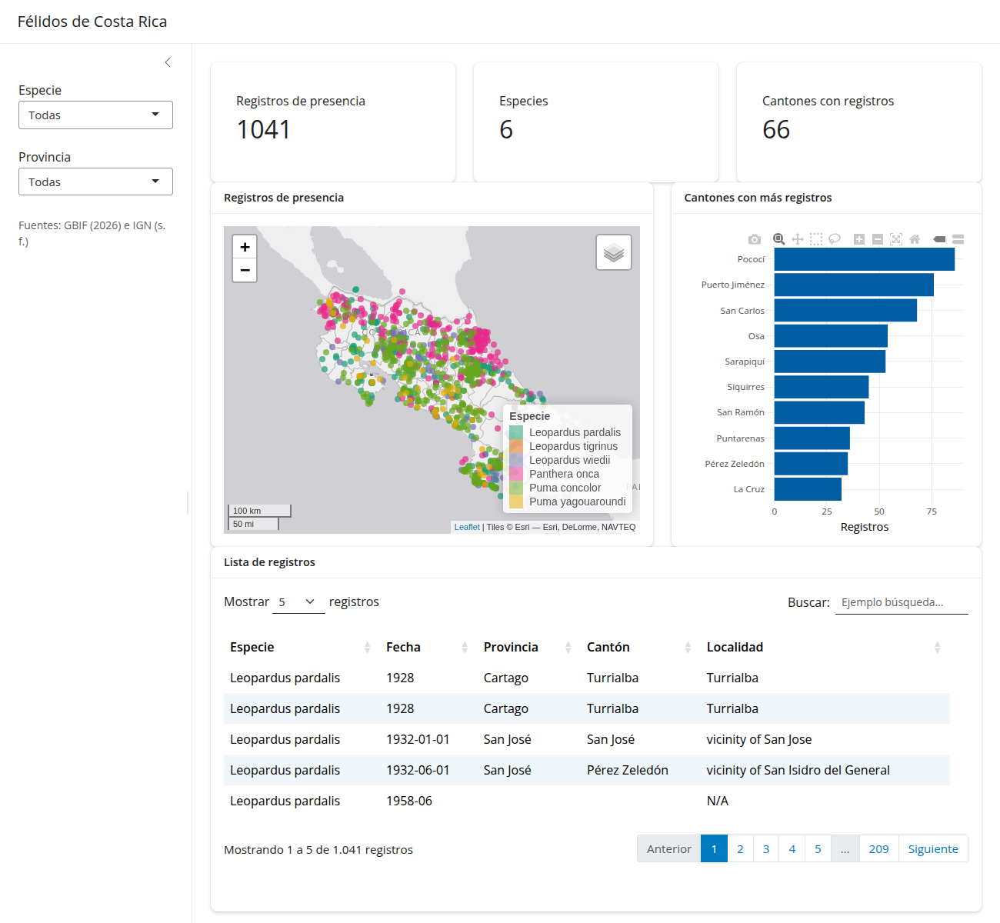

## Trabajo previo

### Lecturas

Antes de la clase, revise las siguientes lecturas. Los cuatro primeros capítulos de *Mastering Shiny* presentan la estructura de una aplicación, la interfaz de usuario, la reactividad y un caso de estudio completo; la guía de inicio de Posit recorre lo mismo en lecciones cortas con ejemplos ejecutables.

Wickham, H. (2021). *Mastering Shiny: Build interactive apps, reports, and dashboards powered by R* (capítulos 1 al 4). O'Reilly Media. <https://mastering-shiny.org/>

Posit. (s. f.). *Shiny for R: Get started*. Recuperado el 11 de noviembre de 2026, de <https://shiny.posit.co/r/getstarted/>

### Otros recursos

Instale los tres paquetes del capítulo antes de la clase: `install.packages(c("shiny", "bslib", "rsconnect"))`. Cree también una cuenta gratuita en [shinyapps.io](https://www.shinyapps.io/), el servicio en que se publicará la aplicación (puede registrarse con su cuenta de GitHub o de Google). La [documentación de bslib](https://rstudio.github.io/bslib/) describe los componentes de la interfaz que usa el capítulo: [barras laterales](https://rstudio.github.io/bslib/articles/sidebars/), [tarjetas](https://rstudio.github.io/bslib/articles/cards/), [cajas de valor](https://rstudio.github.io/bslib/articles/value-boxes/) y [distribución en columnas](https://rstudio.github.io/bslib/articles/column-layout/). La [galería de shiny](https://shiny.posit.co/r/gallery/) muestra aplicaciones con su código, la [hoja de referencia de shiny](https://rstudio.github.io/cheatsheets/html/shiny.html) resume los controles de entrada y las salidas, y la [guía de usuario de shinyapps.io](https://docs.posit.co/shinyapps.io/) explica la publicación.

## Introducción

Los documentos de Quarto de las secciones anteriores son **estáticos** en un sentido preciso: R se ejecuta una vez, cuando se presiona *Render*, y lo que se publica es el resultado. Los gráficos de plotly, las tablas de DT y los mapas de leaflet permiten explorar ese resultado (acercarse, ordenar, buscar), pero no cambiarlo: quien consulta el documento no puede pedir «solo los jaguares de Limón» si quien lo escribió no dejó ese filtro preparado. Una **aplicación web interactiva** sí puede: detrás de la página hay un proceso de R en ejecución, que recibe lo que la persona elige en los controles, vuelve a calcular y actualiza las tablas, los gráficos y los mapas.

[shiny](https://shiny.posit.co/) es el paquete de R para desarrollar esas aplicaciones, sin escribir HTML ni JavaScript. Una aplicación tiene dos partes: la **interfaz de usuario**, que describe lo que se ve (los controles de entrada y los espacios para las salidas), y el **servidor**, una función de R que calcula las salidas a partir de las entradas. Las une la **reactividad**: shiny sabe de cuáles entradas depende cada salida y, cuando una entrada cambia, recalcula solo lo necesario. El paquete [bslib](https://rstudio.github.io/bslib/) aporta los componentes modernos de la interfaz: la página con barra lateral, las tarjetas y las cajas de valor.

Este capítulo construye, en cinco pasos, la aplicación de la figura 1: los registros de presencia de félidos de GBIF, filtrados por especie y por provincia, en tres cajas de valor, un mapa, un gráfico y una tabla. No hay nada nuevo en los datos ni en las visualizaciones: son los cantones y los félidos de los capítulos [16](../iv-ecosistema-geoespacial-r/16-sf-operaciones-espaciales.qmd) y [17](../iv-ecosistema-geoespacial-r/17-leaflet-mapas-web.qmd), la tabla y el gráfico del [capítulo 13](../iii-tidyverse/13-plotly-dt.qmd) y el mapa del capítulo 17. Lo nuevo es la estructura que los hace responder a los controles, y es la misma del **proyecto final** del curso, que consiste en hacer con los datos de su tema lo que este capítulo hace con los félidos.

<figure style="text-align: center;">
  
  <figcaption><strong>Figura 1</strong>. La aplicación que construye este capítulo: registros de presencia de félidos de Costa Rica, filtrados por especie y por provincia. Fuente: elaboración propia con datos de GBIF.org (2026) y del Instituto Geográfico Nacional (s. f.).</figcaption>
</figure>

El código de cada paso está en el repositorio del curso, en la carpeta [`aplicaciones/`](https://github.com/pf0953-programacionr/2026-ii/tree/main/aplicaciones), y se reproduce completo al final de cada sección, para copiarlo. Como una aplicación necesita un proceso de R en ejecución, **el código de este capítulo no se ejecuta en esta página**: se ejecuta en RStudio, en su computadora.

```{r}
#| label: preparacion
#| eval: false
# Paquetes de la aplicación de este capítulo
library(shiny)     # aplicaciones web interactivas
library(bslib)     # componentes de la interfaz de usuario
library(tidyverse)
library(sf)
library(DT)
library(plotly)
library(leaflet)
```

## Estructura de una aplicación

### Cliente y servidor

Un documento HTML publicado en GitHub Pages es un archivo: el navegador lo descarga y lo muestra, y R ya no interviene. Una aplicación shiny es un **programa en ejecución**. Hay dos partes que conversan mientras la aplicación está abierta:

- El **cliente** es el navegador de quien usa la aplicación. Muestra la interfaz de usuario y envía al servidor el valor de cada control cuando cambia.
- El **servidor** es un proceso de R, en su computadora durante el desarrollo y en un servicio como shinyapps.io cuando la aplicación se publica. Recibe los valores, ejecuta el código de R y devuelve los resultados (un texto, una tabla, un gráfico, un mapa), que el navegador coloca en su lugar.

De ahí salen las dos consecuencias prácticas del capítulo: una aplicación shiny **no puede publicarse en GitHub Pages**, que solo sirve archivos, y mientras se ejecuta en RStudio **la consola queda ocupada** atendiéndola.

### Las tres partes del código

Una aplicación shiny es un archivo llamado `app.R`, en una carpeta propia, con tres partes:

```r
library(shiny)
library(bslib)

# 1. Interfaz de usuario: lo que se ve
ui <- page_sidebar(
  # controles de entrada y espacios para las salidas
)

# 2. Servidor: lo que se calcula
server <- function(input, output, session) {
  # código que produce las salidas a partir de las entradas
}

# 3. Aplicación: une las dos partes y la pone en marcha
shinyApp(ui = ui, server = server)
```

La interfaz y el servidor se comunican por dos listas que shiny crea, y que son los argumentos de la función `server`:

- `input` contiene los valores de los **controles de entrada**. Cada control tiene un identificador (`inputId`); el valor de un control con `inputId = "especie"` se lee en el servidor como `input$especie`.
- `output` contiene las **salidas**. Cada espacio para una salida tiene también un identificador; lo que el servidor asigna a `output$conteo` aparece en el espacio que la interfaz reservó con `textOutput("conteo")`.

Los identificadores son el hilo que cose las dos partes: un nombre escrito de dos maneras distintas (una mayúscula, una tilde) es el error más frecuente en una aplicación shiny, y casi nunca produce un mensaje.

### Una primera aplicación

En el proyecto `pf0953` de RStudio, cree una carpeta llamada `aplicacion-felidos` (panel *Files* > *New Folder*) y, dentro de ella, un archivo `app.R` (*File* > *New File* > *R Script*, y *Save* con ese nombre en la carpeta). Copie en él el siguiente código:

```{r}
#| label: paso-1
#| eval: false
#| file: ../../aplicaciones/pasos/paso-1/app.R
```

RStudio reconoce el archivo como una aplicación shiny y cambia el botón *Run* por **Run App**. Al presionarlo, la aplicación se abre en una ventana: una barra lateral con una lista de selección y, a la derecha, un texto, `Leopardus pardalis: 289 registros de presencia`. Al elegir otra especie, el texto cambia: `Panthera onca: 246 registros de presencia`. En la consola aparece `Listening on http://127.0.0.1:…` y deja de aceptar comandos: R está atendiendo la aplicación. Para detenerla, se cierra la ventana o se presiona el botón rojo **Stop** de la consola.

El recorrido completo, de arriba abajo:

1. **Paquetes y datos**. Lo que está fuera de `ui` y de `server` se ejecuta **una sola vez**, cuando la aplicación arranca: se cargan los paquetes, se lee el archivo de félidos desde la URL del curso y se calcula la lista de especies. Es el lugar para todo lo que no depende de lo que elija la persona.
2. **Interfaz**. [`page_sidebar()`](https://rstudio.github.io/bslib/reference/page_sidebar.html) crea una página con título, una barra lateral (`sidebar = sidebar(…)`) y un área principal. En la barra lateral, [`selectInput()`](https://shiny.posit.co/r/reference/shiny/latest/selectinput.html) crea una lista de selección con tres argumentos: el identificador (`inputId`), la etiqueta que se muestra (`label`) y las opciones (`choices`). En el área principal, [`textOutput("conteo")`](https://shiny.posit.co/r/reference/shiny/latest/textoutput.html) reserva un espacio para un texto. Los elementos se separan con **comas**, porque son argumentos de una función.
3. **Servidor**. `output$conteo <- renderText({ … })` dice cómo se produce ese texto. El código entre las llaves es R corriente (un `filter()` de dplyr y un `paste0()`), con una diferencia: usa `input$especie`. Shiny lo nota y vuelve a ejecutar el bloque **cada vez que ese valor cambia**. Nadie escribe «cuando cambie la lista, actualice el texto»: basta con usar el valor.
4. **Aplicación**. `shinyApp(ui = ui, server = server)` es siempre la última línea.

Cada tipo de salida tiene una pareja de funciones: una `…Output()` en la interfaz, que reserva el espacio, y una `render…()` en el servidor, que lo llena. La tabla 1 presenta las que usa el curso.

<figure style="text-align: center; margin: 20px 0;">
    <figcaption><strong>Tabla 1</strong>. Parejas de funciones de salida de shiny y de los paquetes de htmlwidgets del curso. Fuente: elaboración propia con base en Chang et al. (2026).</figcaption>
    <table class="table table-bordered table-striped" style="margin: 0 auto;">
    <thead>
      <tr><th>Salida</th><th>En la interfaz</th><th>En el servidor</th><th>Paquete</th></tr>
    </thead>
    <tbody>
      <tr><td>Texto</td><td><code>textOutput()</code></td><td><code>renderText()</code></td><td>shiny</td></tr>
      <tr><td>Tabla estática</td><td><code>tableOutput()</code></td><td><code>renderTable()</code></td><td>shiny</td></tr>
      <tr><td>Gráfico estático (ggplot2)</td><td><code>plotOutput()</code></td><td><code>renderPlot()</code></td><td>shiny</td></tr>
      <tr><td>Tabla interactiva</td><td><code>DTOutput()</code></td><td><code>renderDT()</code></td><td>DT</td></tr>
      <tr><td>Gráfico interactivo</td><td><code>plotlyOutput()</code></td><td><code>renderPlotly()</code></td><td>plotly</td></tr>
      <tr><td>Mapa web</td><td><code>leafletOutput()</code></td><td><code>renderLeaflet()</code></td><td>leaflet</td></tr>
    </tbody>
    </table>
</figure>

*Ejercicios de esta sección: [ejercicios sobre la estructura](#ejercicios-estructura).*

## Controles de entrada

Todos los controles de entrada siguen el patrón de `selectInput()`: los dos primeros argumentos son el identificador y la etiqueta, y los demás dependen del control. La tabla 2 resume los más usados y, sobre todo, **qué devuelve cada uno** en `input$…`, porque de eso depende el código del servidor: una lista de selección devuelve un texto, un deslizador de rango devuelve un vector de dos números y un grupo de casillas devuelve un vector de textos de longitud variable, que se compara con `%in%` y no con `==`.

<figure style="text-align: center; margin: 20px 0;">
    <figcaption><strong>Tabla 2</strong>. Controles de entrada de shiny más usados. Fuente: elaboración propia con base en Chang et al. (2026).</figcaption>
    <table class="table table-bordered table-striped" style="margin: 0 auto;">
    <thead>
      <tr><th>Función</th><th>Control</th><th>Valor en <code>input&#36;…</code></th><th>Uso típico en el servidor</th></tr>
    </thead>
    <tbody>
      <tr><td><code>selectInput()</code></td><td>Lista de selección</td><td>Un texto (o varios, con <code>multiple = TRUE</code>)</td><td><code>filter(columna == input&#36;id)</code></td></tr>
      <tr><td><code>radioButtons()</code></td><td>Botones de opción única</td><td>Un texto</td><td><code>filter(columna == input&#36;id)</code></td></tr>
      <tr><td><code>checkboxGroupInput()</code></td><td>Casillas de selección múltiple</td><td>Un vector de textos (vacío si no hay ninguna marcada)</td><td><code>filter(columna %in% input&#36;id)</code></td></tr>
      <tr><td><code>checkboxInput()</code></td><td>Una casilla</td><td><code>TRUE</code> o <code>FALSE</code></td><td><code>if (input&#36;id) { … }</code></td></tr>
      <tr><td><code>sliderInput()</code></td><td>Deslizador</td><td>Un número, o dos si <code>value</code> es un vector de dos (un rango)</td><td><code>filter(columna &gt;= input&#36;id[1], columna &lt;= input&#36;id[2])</code></td></tr>
      <tr><td><code>numericInput()</code></td><td>Casilla numérica</td><td>Un número</td><td><code>head(input&#36;id)</code></td></tr>
      <tr><td><code>dateRangeInput()</code></td><td>Rango de fechas</td><td>Un vector de dos fechas</td><td><code>filter(fecha &gt;= input&#36;id[1], fecha &lt;= input&#36;id[2])</code></td></tr>
      <tr><td><code>textInput()</code></td><td>Casilla de texto</td><td>Un texto</td><td><code>filter(str_detect(columna, input&#36;id))</code></td></tr>
      <tr><td><code>actionButton()</code></td><td>Botón</td><td>Un contador de clics</td><td>Con <code>observeEvent()</code> o <code>bindEvent()</code></td></tr>
    </tbody>
    </table>
</figure>

Dos recomendaciones para elegir un control. Las opciones se **calculan a partir de los datos** (`choices = sort(unique(felidos$species))`) en lugar de escribirse a mano: así no hay errores de digitación y la lista se actualiza sola si los datos cambian. Y el control debe corresponder al tipo de la variable: una lista o unos botones para una variable categórica, un deslizador para una numérica, un rango de fechas para una fecha.

*Ejercicios de esta sección: [ejercicios sobre los controles de entrada](#ejercicios-controles).*

## Reactividad

### De una salida a varias

La primera aplicación tiene una sola salida, y el filtro está dentro de su `renderText()`. La aplicación de la figura 1 tiene siete salidas, y las siete necesitan los mismos registros filtrados. Repetir el filtro en cada una sería copiar siete veces el mismo código (y corregirlo siete veces) y ejecutarlo siete veces en cada cambio. La solución es una **expresión reactiva**: un cálculo intermedio, creado con [`reactive()`](https://shiny.posit.co/r/reference/shiny/latest/reactive.html), que depende de las entradas y del que dependen las salidas.

```r
server <- function(input, output, session) {
  # Expresión reactiva: los registros que cumplen los filtros
  felidos_filtrados <- reactive({
    filtrados <- felidos

    if (input$especie != "Todas") {
      filtrados <- filter(filtrados, species == input$especie)
    }

    if (input$provincia != "Todas") {
      filtrados <- filter(filtrados, provincia == input$provincia)
    }

    filtrados
  })

  # Texto con la cantidad de registros filtrados
  output$conteo <- renderText({
    paste(nrow(felidos_filtrados()), "registros de presencia")
  })
}
```

Tres cosas distinguen a una expresión reactiva de una variable corriente:

- Se **usa con paréntesis**, como una función: `felidos_filtrados()`, no `felidos_filtrados`. Olvidarlos es el segundo error más frecuente del capítulo.
- Es **perezosa y guarda su resultado**: no se calcula hasta que una salida la pide, y si siete salidas la piden, se calcula una vez. Solo se vuelve a calcular cuando cambia una de las entradas que usa.
- Solo puede usarse **dentro de otro contexto reactivo**: una función `render…()` u otra `reactive()`. Lo mismo vale para `input$…`: leerlo directamente en el cuerpo de `server`, fuera de esos contextos, es un error.

El filtro tiene además un detalle de diseño. Cada lista de selección ofrece la opción `"Todas"`, que no es un valor de los datos: por eso el filtro de cada control solo se aplica, con un `if`, cuando se eligió otra cosa. El resultado de la expresión es su última línea, `filtrados`, como en una función.

El conjunto de dependencias forma el **grafo reactivo** de la aplicación (figura 2): las entradas a la izquierda, las salidas a la derecha y, en medio, la expresión reactiva. Shiny lo construye solo, observando qué usa cada bloque, y lo recorre en cada cambio: si cambia la especie, se recalcula `felidos_filtrados()` y, después, todas las salidas que la usan.

::: {style="text-align: center; margin: 20px 0;"}

```{mermaid}
flowchart LR
  E["input$especie"] --> R(["felidos_filtrados()"])
  P["input$provincia"] --> R
  R --> C["Cajas de valor<br>output$registros, output$especies, output$cantones"]
  R --> M["Mapa<br>output$mapa"]
  R --> G["Gráfico<br>output$grafico"]
  R --> T["Tabla<br>output$tabla"]
```

**Figura 2**. Grafo reactivo de la aplicación de félidos: los controles de entrada alimentan la expresión reactiva, cuyo resultado comparten todas las salidas. Fuente: elaboración propia.

:::

### Dónde se ejecuta cada parte

El código de `app.R` se ejecuta con tres frecuencias distintas, y saber cuál corresponde a cada línea es lo que hace que una aplicación sea rápida o lenta:

- Lo que está **fuera de `ui` y `server`** se ejecuta una vez, al arrancar la aplicación: la lectura de los datos y toda la preparación que no depende de los controles (convertir a sf, reproyectar, unir, calcular columnas). Es la parte más lenta y, por eso, va aquí.
- El **cuerpo de `server`** se ejecuta una vez por cada persona que abre la aplicación (una *sesión*).
- Las **expresiones reactivas y las funciones `render…()`** se ejecutan cada vez que cambia una de sus entradas: deben contener solo lo que depende de ellas, es decir, filtrar y dibujar.

La regla que resulta: **preparar afuera, filtrar adentro**. Una unión espacial dentro de `reactive()` se repetiría con cada clic.

### Una tabla que responde a dos filtros

El segundo paso de la aplicación aplica todo lo anterior. Los datos se preparan como en el capítulo 17 (los félidos, convertidos en puntos y unidos espacialmente a los cantones, de modo que cada registro tenga su `canton` y su `provincia`; se mide en CRTM05 y se termina en WGS84, porque la capa acabará en un mapa de leaflet). Hay dos listas de selección, la expresión reactiva de arriba y dos salidas que la comparten: el texto y una tabla de DT, con el `datatable()` del capítulo 13 dentro de [`renderDT()`](https://rstudio.github.io/DT/shiny.html):

```r
  # Tabla
  output$tabla <- renderDT({
    felidos_filtrados() |>
      st_drop_geometry() |>
      select(species, eventDate, provincia, canton, locality) |>
      datatable(
        rownames = FALSE,
        colnames = c("Especie", "Fecha", "Provincia", "Cantón", "Localidad"),
        options = list(
          pageLength = 5,
          language = list(url = "https://cdn.datatables.net/plug-ins/2.3.2/i18n/es-ES.json")
        )
      )
  })
```

En la interfaz, la tabla va dentro de una **tarjeta**, [`card()`](https://rstudio.github.io/bslib/reference/card.html), el contenedor de bslib con borde y encabezado (`card_header()`), y la página se declara `fillable = FALSE` para que se comporte como un documento, que crece hacia abajo y se desplaza, en lugar de repartir la altura de la ventana entre sus elementos:

```r
  textOutput("conteo"),
  card(
    card_header("Lista de registros"),
    DTOutput("tabla")
  ),
  fillable = FALSE
```

Sustituya el contenido de `app.R` por el código completo de este paso y ejecute la aplicación. Al arrancar tarda unos segundos más, por la lectura de los cantones y la unión espacial. Con `Todas` y `Todas`, el texto dice `1041 registros de presencia`; con `Panthera onca` y `Puntarenas`, `11`; con `Todas` y `Limón`, `204`. La tabla cambia con el texto, y sus propios controles (buscar, ordenar, paginar) siguen funcionando sobre los registros filtrados.

```{r}
#| label: paso-2
#| eval: false
#| file: ../../aplicaciones/pasos/paso-2/app.R
#| code-fold: true
#| code-summary: "Código completo de `app.R` en el paso 2 (clic para mostrar)"
```

*Ejercicios de esta sección: [ejercicios sobre la reactividad](#ejercicios-reactividad).*

## Gráficos y mapas reactivos

El patrón de la tabla sirve para cualquier salida: el código de la visualización, **tal como se escribió en un documento de Quarto**, se coloca dentro de la función `render…()` correspondiente, y donde decía el nombre del conjunto de datos se escribe la expresión reactiva. Convertir un documento en una aplicación es, en buena parte, mover código.

### Un gráfico interactivo

El tercer paso agrega un gráfico de barras de los diez cantones con más registros, con ggplot2 y `ggplotly()` como en el capítulo 13: la etiqueta emergente en la estética `text`, `tooltip = "text"` y `config()` para el idioma. El conteo por cantón se hace dentro de `renderPlotly()`, porque depende de los filtros:

```r
  # Gráfico
  output$grafico <- renderPlotly({
    validate(need(nrow(felidos_filtrados()) > 0, "No hay registros con estos filtros."))

    registros_canton <- felidos_filtrados() |>
      st_drop_geometry() |>
      filter(!is.na(canton)) |>
      count(canton, name = "registros", sort = TRUE) |>
      head(10)

    grafico <- registros_canton |>
      ggplot(aes(
        x = registros,
        y = fct_reorder(canton, registros),
        text = paste0(canton, ": ", registros, " registros")
      )) +
      geom_col(fill = "#005da4") +
      labs(x = "Registros", y = NULL) +
      theme_minimal()

    ggplotly(grafico, tooltip = "text") |>
      config(locale = "es", displaylogo = FALSE)
  })
```

La primera línea es nueva, y resuelve un problema que los documentos no tienen: **la persona puede elegir una combinación sin datos**. `Leopardus tigrinus`, con solo tres registros en el país, no tiene ninguno en Guanacaste. Un gráfico o un mapa de cero filas suele terminar en un mensaje de error en rojo dentro de la aplicación, incomprensible para quien la usa. [`validate(need(condición, mensaje))`](https://shiny.posit.co/r/reference/shiny/latest/validate.html) comprueba la condición y, si no se cumple, detiene el bloque y muestra el mensaje, en gris, en el lugar de la salida. Toda salida que pueda quedarse sin datos debería empezar así.

En la interfaz, el gráfico se agrega en otra tarjeta, antes de la tabla, con `plotlyOutput("grafico")`. Al ejecutar: con `Todas` y `Todas`, la barra más larga es la de Pococí (86 registros), seguida de Puerto Jiménez (76) y San Carlos (68); con `Limón`, quedan seis barras, de Pococí (86) a Limón (12).

```{r}
#| label: paso-3
#| eval: false
#| file: ../../aplicaciones/pasos/paso-3/app.R
#| code-fold: true
#| code-summary: "Código completo de `app.R` en el paso 3 (clic para mostrar)"
```

### Un mapa web

El cuarto paso agrega el mapa de leaflet del capítulo 17, dentro de [`renderLeaflet()`](https://rstudio.github.io/leaflet/articles/shiny.html): dos mapas base con su control, los cantones como contorno de referencia y los registros filtrados como círculos de colores, con etiqueta y ventana emergente. Los cantones y la paleta no dependen de los filtros y se preparan fuera del servidor; dentro, solo `felidos_filtrados()`:

```r
  # Mapa
  output$mapa <- renderLeaflet({
    validate(need(nrow(felidos_filtrados()) > 0, "No hay registros con estos filtros."))

    leaflet() |>
      addProviderTiles(providers$Esri.WorldGrayCanvas, group = "Fondo gris (Esri)") |>
      addTiles(group = "OpenStreetMap") |>
      addPolygons(
        data = cantones,
        color = "#666666",
        weight = 0.5,
        fillOpacity = 0,
        label = ~canton
      ) |>
      addCircleMarkers(
        data = felidos_filtrados(),
        radius = 4,
        color = ~paleta_especies(species),
        fillOpacity = 0.7,
        stroke = FALSE,
        label = ~species,
        popup = ~paste0("<b>", species, "</b><br>", eventDate, "<br>", locality)
      ) |>
      addLegend(position = "bottomright", pal = paleta_especies, values = especies, title = "Especie") |>
      addLayersControl(baseGroups = c("Fondo gris (Esri)", "OpenStreetMap")) |>
      setView(lng = -84.2, lat = 9.9, zoom = 7) |>
      addScaleBar(position = "bottomleft")
  })
```

Dos decisiones merecen comentario. La paleta se construye **una vez, con todas las especies** (`paleta_especies <- colorFactor(palette = "Dark2", domain = especies)`, fuera del servidor), y no con las especies filtradas: así el jaguar tiene siempre el mismo color, se muestre solo o con las demás. Y `setView()` fija la vista inicial en el territorio continental; sin él, el mapa se ajustaría a la extensión de los cantones, que incluye la Isla del Coco. Aquí `validate()` no es un adorno: sin esa línea, `addCircleMarkers()` con una capa de cero filas produce el error `invalid 'type' (list) of argument`.

El mapa se **vuelve a dibujar completo** con cada cambio de los filtros, y por eso regresa a la vista inicial aunque la persona se hubiera acercado. Para capas de este tamaño es aceptable; la alternativa, [`leafletProxy()`](https://rstudio.github.io/leaflet/articles/shiny.html), que modifica el mapa existente sin redibujarlo, se menciona en la lectura complementaria. Al ejecutar: con `Panthera onca`, el mapa muestra solo puntos rosados, concentrados en el Caribe norte, la zona norte y Guanacaste, y la leyenda conserva las seis especies.

```{r}
#| label: paso-4
#| eval: false
#| file: ../../aplicaciones/pasos/paso-4/app.R
#| code-fold: true
#| code-summary: "Código completo de `app.R` en el paso 4 (clic para mostrar)"
```

*Ejercicios de esta sección: [ejercicios sobre gráficos y mapas](#ejercicios-salidas).*

## Diseño de la interfaz con bslib

Con las salidas funcionando, el último paso las ordena. bslib ofrece pocos componentes, que se anidan:

- [`layout_columns()`](https://rstudio.github.io/bslib/reference/layout_columns.html) coloca sus elementos **uno al lado del otro**, en una rejilla de 12 columnas: `col_widths = c(7, 5)` da siete columnas al primero y cinco al segundo; sin `col_widths`, el ancho se reparte por igual. En pantallas angostas, como las de un teléfono, los elementos se apilan solos.
- [`card()`](https://rstudio.github.io/bslib/reference/card.html) es la tarjeta, con `card_header()` para el título y `full_screen = TRUE` para agregar el botón que la amplía a toda la ventana.
- [`value_box()`](https://rstudio.github.io/bslib/reference/value_box.html) es la **caja de valor**: un indicador numérico destacado, con un título (`title`) y un valor (`value`). El valor puede ser una salida: `value = textOutput("registros")`.
- [`navset_card_tab()`](https://rstudio.github.io/bslib/reference/navset.html) y `nav_panel()` reparten el contenido en **pestañas**, cuando no cabe en una sola vista.

En la aplicación, el texto con el conteo se sustituye por tres cajas de valor en una fila; debajo, el mapa y el gráfico comparten otra fila, y la tabla ocupa la tercera:

```r
  layout_columns(
    value_box(title = "Registros de presencia", value = textOutput("registros")),
    value_box(title = "Especies", value = textOutput("especies")),
    value_box(title = "Cantones con registros", value = textOutput("cantones")),
    fill = FALSE
  ),
  layout_columns(
    card(
      card_header("Registros de presencia"),
      leafletOutput("mapa"),
      full_screen = TRUE
    ),
    card(
      card_header("Cantones con más registros"),
      plotlyOutput("grafico"),
      full_screen = TRUE
    ),
    col_widths = c(7, 5)
  ),
  card(
    card_header("Lista de registros"),
    DTOutput("tabla"),
    full_screen = TRUE
  ),
  fillable = FALSE
```

En el servidor, cada caja de valor es un `renderText()` de una línea sobre la expresión reactiva, y la barra lateral gana un texto con las fuentes de los datos, con `helpText()`:

```r
  # Cajas de valor
  output$registros <- renderText({
    nrow(felidos_filtrados())
  })

  output$especies <- renderText({
    n_distinct(felidos_filtrados()$species)
  })

  output$cantones <- renderText({
    n_distinct(felidos_filtrados()$canton, na.rm = TRUE)
  })
```

Con el código completo, que es el archivo [`aplicaciones/felidos/app.R`](https://github.com/pf0953-programacionr/2026-ii/blob/main/aplicaciones/felidos/app.R) del repositorio, la aplicación es la de la figura 1. Con `Todas` y `Todas`, las cajas muestran 1041 registros, 6 especies y 66 cantones; con `Panthera onca`, 246, 1 y 36; con `Limón`, 204, 5 y 6. Con `Leopardus tigrinus` y `Guanacaste`, las cajas muestran ceros, la tabla queda vacía, y el mapa y el gráfico muestran el mensaje «No hay registros con estos filtros.».

```{r}
#| label: paso-5
#| eval: false
#| file: ../../aplicaciones/felidos/app.R
#| code-fold: true
#| code-summary: "Código completo de `app.R` en el paso 5, la aplicación terminada (clic para mostrar)"
```

El aspecto general se cambia con el argumento `theme` de `page_sidebar()` y la función [`bs_theme()`](https://rstudio.github.io/bslib/reference/bs_theme.html): `theme = bs_theme(bootswatch = "flatly")` aplica uno de los temas de [Bootswatch](https://bootswatch.com/), y `theme = bs_theme(primary = "#005da4")` cambia solo el color principal. Y una advertencia sobre el código que se encuentra en Internet y el que generan los asistentes de IA: mucho de él usa las funciones de diseño anteriores a bslib (`fluidPage()`, `sidebarLayout()`, `sidebarPanel()`, `mainPanel()`) o el paquete shinydashboard. Funcionan, y el servidor se escribe igual, pero no se mezclan bien con las tarjetas y las cajas de valor de este capítulo: conviene pedir explícitamente bslib.

*Ejercicios de esta sección: [ejercicios sobre el diseño](#ejercicios-diseno).*

## Publicación en shinyapps.io

Una aplicación shiny necesita un servidor con R. [shinyapps.io](https://www.shinyapps.io/) es el servicio de Posit que lo ofrece, con un plan gratuito suficiente para el proyecto del curso: al momento de escribir este capítulo, hasta cinco aplicaciones y 25 horas de uso al mes (las [condiciones vigentes](https://www.shinyapps.io/#pricing) están en su sitio). El paquete [rsconnect](https://rstudio.github.io/rsconnect/) sube la carpeta de la aplicación; el servicio instala en el servidor los paquetes que el código carga con `library()` y le asigna una dirección pública.

La cuenta se conecta una sola vez por computadora:

1. Ingrese a [shinyapps.io](https://www.shinyapps.io/) y cree su cuenta. El nombre de cuenta que elija será parte de la dirección de sus aplicaciones (`https://cuenta.shinyapps.io/…`).
2. En el menú de la cuenta, abra *Account* > *Tokens*, presione *Show* y luego *Show secret* y *Copy to clipboard*. Lo que se copia es un comando de R completo, como este (con sus datos en lugar de los puntos suspensivos):

    ```r
    rsconnect::setAccountInfo(name = "cuenta", token = "…", secret = "…")
    ```

3. Pegue el comando en la **consola** de RStudio y ejecútelo.

::: {.callout-warning}
## El token es una contraseña

El comando con el `token` y el `secret` da acceso a su cuenta. Se ejecuta en la consola y **no se escribe en `app.R`**, ni en ningún archivo que se suba a GitHub, ni se pega en un asistente de IA o en un chat. Si se expone, se revoca en la misma página de *Tokens* y se genera otro.
:::

Con la cuenta conectada, la aplicación se publica con una línea en la consola, con el nombre de la carpeta, o con el botón azul **Publish** que RStudio muestra junto a *Run App*:

```r
rsconnect::deployApp("aplicacion-felidos")
```

El proceso tarda varios minutos la primera vez, porque el servidor instala los paquetes (sf entre ellos); al terminar, abre la aplicación en el navegador, en `https://cuenta.shinyapps.io/aplicacion-felidos/`. Para actualizarla después de un cambio, se ejecuta el mismo comando. Tres condiciones para que funcione en el servidor lo que funciona en su computadora:

- **Todo lo que la aplicación necesita está en su carpeta, o en una URL**. La aplicación de félidos lee sus datos de la URL del curso. Si los suyos son archivos, van dentro de la carpeta de la aplicación (por ejemplo, en `aplicacion-felidos/datos/`) y se leen con una **ruta relativa** a ella: `read_csv("datos/archivo.csv")`. Una ruta de su computadora (`C:/Users/…`) o un `setwd()` hacen que la aplicación publicada falle al arrancar.
- **Los paquetes se cargan con `library()` en `app.R`** y están instalados en su computadora: rsconnect lee de ahí la lista y las versiones que pide al servidor.
- **La aplicación arranca en un tiempo razonable y con poca memoria**. El plan gratuito ofrece una cantidad limitada de memoria y detiene las aplicaciones inactivas, de modo que cada visita después de un rato vuelve a arrancarla. Si la preparación de los datos es pesada, se hace una vez en un script aparte y la aplicación lee el resultado ya preparado (un `.gpkg` o un `.csv` con las columnas necesarias y las geometrías simplificadas con `st_simplify()`), como se recomendó para los mapas en el capítulo 17.

Si la aplicación publicada muestra «An error has occurred» o «Application failed to start», el mensaje de R está en el registro del servidor: `rsconnect::showLogs("aplicacion-felidos")` en la consola, o la pestaña *Logs* de la aplicación en el panel de shinyapps.io.

*Ejercicios de esta sección: [ejercicios sobre publicación, asistentes y proyecto final](#ejercicios-publicacion).*

## Asistentes de IA para desarrollar aplicaciones

Una aplicación tiene más piezas que un gráfico, y por eso el contexto del prompt pesa más: hay que describir los datos (objetos, columnas, tipos, SRC), los controles que se quieren, las salidas y el marco de la interfaz. Y hay más que verificar. Las comprobaciones son cinco: que la **interfaz use bslib** (`page_sidebar()`, `card()`, `value_box()`) y no funciones de otros paquetes o de versiones anteriores; que haya **una expresión reactiva** compartida por las salidas, en lugar del mismo filtro copiado en cada una, y que la preparación de los datos esté **fuera del servidor**; que los **identificadores coincidan** entre la interfaz y el servidor y que las columnas existan en los datos; que no haya **rutas locales, `setwd()`, `install.packages()` ni credenciales** en el código; y que la aplicación **funcione** con cada control, incluida una combinación sin datos. Un prompt de ejemplo:

> Actúe como asistente de desarrollo de aplicaciones web con R y shiny **(rol)**. Tengo un objeto sf llamado `felidos`, con 1 041 puntos en WGS84 y las columnas `species` (texto, seis especies), `year` (entero, de 1928 a 2026, con valores faltantes), `provincia` y `canton` (texto), y un objeto sf llamado `cantones`, con 84 multipolígonos en WGS84 y las columnas `canton` y `provincia`; ambos se leen y se preparan antes de la interfaz **(contexto)**. Escriba una aplicación shiny en un solo archivo `app.R`, con una barra lateral con una lista de selección de especie (con la opción «Todas») y un deslizador de rango de años, y en el área principal una caja de valor con la cantidad de registros, un mapa de leaflet con los registros como círculos coloreados por especie y un gráfico de barras de plotly con los registros por año **(tarea)**. Use bslib (`page_sidebar()`, `card()`, `value_box()` y `layout_columns()`), una sola expresión `reactive()` para el filtro, compartida por todas las salidas, `validate(need())` para el caso sin registros, y agregue un comentario por sección; no use shinydashboard ni `fluidPage()` **(formato)**.

En un proyecto como el final, el riesgo no es que el asistente escriba código que no funcione, sino que escriba una aplicación que funcione y que usted **no pueda explicar**: en la presentación oral se le pedirá que muestre en el código qué pasa cuando cambia un control. Pida piezas, no la aplicación entera, y siga el camino de este capítulo: primero una salida, luego la expresión reactiva, luego las demás.

*Ejercicios de esta sección: [ejercicios sobre publicación, asistentes y proyecto final](#ejercicios-publicacion).*

## Clínica de errores

Los errores de una aplicación shiny aparecen en tres lugares: en la **consola** de RStudio, cuando la aplicación no llega a arrancar; **dentro de la aplicación**, en rojo, en el lugar de la salida que falló (las demás siguen funcionando); y en **ninguno**, cuando un identificador no coincide y una salida simplemente no aparece. Para ver qué valor tiene una entrada o cuántas filas tiene la expresión reactiva en un momento dado, sirve el recurso más viejo: un `print()` dentro del bloque, cuyo resultado sale en la consola mientras la aplicación corre.

```r
  felidos_filtrados <- reactive({
    print(input$especie)  # se muestra en la consola con cada cambio
    # …
  })
```

La tabla 3 recoge los errores más frecuentes.

<figure style="text-align: center; margin: 20px 0;">
    <figcaption><strong>Tabla 3</strong>. Clínica de errores de las aplicaciones shiny. Fuente: elaboración propia.</figcaption>
    <table class="table table-bordered table-striped" style="margin: 0 auto;">
    <thead>
    <tr><th>Mensaje o síntoma</th><th>Causa</th><th>Solución</th></tr>
    </thead>
    <tbody>
    <tr><td>Una salida no aparece, sin ningún mensaje</td><td>El identificador de la interfaz (<code>textOutput(&quot;conteo&quot;)</code>) y el del servidor (<code>output&#36;Conteo</code>) no coinciden.</td><td>Copiar el mismo nombre en los dos lugares; minúsculas, sin tildes ni espacios.</td></tr>
    <tr><td><code>must be of size 1041 or 1, not size 0</code> en un <code>filter()</code></td><td><code>input&#36;…</code> con un identificador que no existe (<code>input&#36;Especie</code>): vale <code>NULL</code>.</td><td>Usar el <code>inputId</code> exacto del control.</td></tr>
    <tr><td><code>no applicable method for &#39;filter&#39; applied to an object of class &quot;c(&#39;reactiveExpr&#39;, &#39;reactive&#39;, &#39;function&#39;)&quot;</code> (o <code>&#39;select&#39;</code>, <code>&#39;st_drop_geometry&#39;</code>…)</td><td>La expresión reactiva se usó sin paréntesis.</td><td><code>felidos_filtrados()</code>.</td></tr>
    <tr><td>El conteo sale vacío: «registros de presencia», sin número</td><td><code>nrow(felidos_filtrados)</code>, sin paréntesis: <code>nrow()</code> de una función es <code>NULL</code>, sin error.</td><td><code>nrow(felidos_filtrados())</code>.</td></tr>
    <tr><td><code>Can&#39;t access reactive value &#39;especie&#39; outside of reactive consumer</code>, y la aplicación se cierra al abrirse</td><td><code>input&#36;…</code> o una expresión reactiva usados directamente en el cuerpo de <code>server</code>.</td><td>Mover el código dentro de <code>reactive()</code> o de una función <code>render…()</code>.</td></tr>
    <tr><td><code>Unexpected integer output for conteo</code> (o <code>character</code>, <code>data.frame</code>…)</td><td>Se asignó un valor a <code>output&#36;…</code> sin función <code>render…()</code>.</td><td><code>output&#36;conteo &lt;- renderText({ … })</code>.</td></tr>
    <tr><td><code>unexpected symbol</code> al ejecutar, con el número de una línea de la interfaz</td><td>Falta una coma entre dos elementos de la interfaz.</td><td>Revisar la línea <strong>anterior</strong> a la señalada.</td></tr>
    <tr><td><code>could not find function &quot;page_sidebar&quot;</code> (o <code>&quot;renderDT&quot;</code>, <code>&quot;leafletOutput&quot;</code>…)</td><td>Falta el <code>library()</code> del paquete en <code>app.R</code>.</td><td>Cargar bslib, DT, plotly o leaflet al inicio.</td></tr>
    <tr><td><code>invalid &#39;type&#39; (list) of argument</code> en el mapa, con ciertos filtros</td><td>La capa filtrada tiene cero filas.</td><td><code>validate(need(nrow(…) &gt; 0, &quot;mensaje&quot;))</code> al inicio del bloque.</td></tr>
    <tr><td>El filtro de casillas da resultados incompletos, con la advertencia <code>longer object length is not a multiple of shorter object length</code></td><td>Un control de selección múltiple comparado con <code>==</code>.</td><td><code>filter(columna %in% input&#36;id)</code>.</td></tr>
    <tr><td>El botón <em>Run App</em> no aparece</td><td>El archivo no se llama <code>app.R</code> o no termina con <code>shinyApp()</code>.</td><td>Renombrarlo y revisar la última línea.</td></tr>
    <tr><td>La consola no responde a los comandos</td><td>La aplicación sigue en ejecución.</td><td>Cerrar su ventana o presionar <em>Stop</em>.</td></tr>
    <tr><td>La aplicación se pone gris</td><td>El proceso de R se detuvo (por un error, o porque se presionó <em>Stop</em>).</td><td>Leer el error en la consola y volver a ejecutar.</td></tr>
    <tr><td>La aplicación tarda en responder a cada cambio</td><td>Lectura de datos u operaciones espaciales dentro de <code>reactive()</code> o de <code>render…()</code>.</td><td>Preparar afuera, filtrar adentro.</td></tr>
    <tr><td>Publicada, la aplicación muestra «Application failed to start»</td><td>Ruta local, archivo de datos fuera de la carpeta o paquete sin <code>library()</code>.</td><td><code>rsconnect::showLogs()</code>; rutas relativas y datos dentro de la carpeta.</td></tr>
    <tr><td><code>deployApp()</code> responde que no hay ninguna cuenta registrada</td><td>No se ejecutó <code>setAccountInfo()</code> en esta computadora.</td><td>Copiar el comando de <em>Account &gt; Tokens</em> y ejecutarlo en la consola.</td></tr>
    </tbody>
    </table>
</figure>

## Lectura complementaria

**Tableros de Quarto**. Quarto tiene un formato propio para tableros de control, [`format: dashboard`](https://quarto.org/docs/dashboards/), que organiza en filas, columnas, tarjetas y cajas de valor las salidas de un documento, con los encabezados de Markdown como estructura. Un tablero es estático, como cualquier documento (se publica en GitHub Pages), y puede hacerse interactivo [agregándole shiny](https://quarto.org/docs/dashboards/interactivity/shiny-r.html) con `server: shiny` en el encabezado YAML. El resultado es equivalente al de este capítulo, con otra sintaxis; el curso usa `app.R` porque separa con claridad la interfaz del servidor.

**Modificar un mapa sin redibujarlo**. [`leafletProxy("mapa")`](https://rstudio.github.io/leaflet/articles/shiny.html), dentro de un `observe()`, modifica un mapa ya dibujado: con `clearMarkers()` y `addCircleMarkers()` se sustituyen los puntos sin perder la vista ni el mapa base elegido. Vale la pena cuando las capas son pesadas o cuando molesta que el mapa regrese a su vista inicial.

**Controles que dependen de otros controles**. [`updateSelectInput()`](https://shiny.posit.co/r/reference/shiny/latest/updateselectinput.html), dentro de un `observe()`, cambia las opciones de una lista según el valor de otra (los cantones de la provincia elegida). El capítulo 10 de *Mastering Shiny* lo desarrolla.

## Resumen

- Una **aplicación shiny** es un programa en ejecución: el navegador (cliente) muestra la interfaz y envía los valores de los controles; un proceso de R (servidor) calcula y devuelve las salidas. Por eso no se publica en GitHub Pages, sino en un servicio con R, como shinyapps.io.
- El archivo `app.R` tiene tres partes: la **interfaz** (`ui`), con los controles de entrada y los espacios `…Output()`; el **servidor** (`server`), con las funciones `render…()`; y `shinyApp()`. Los **identificadores** unen las dos partes: `input$id` lee un control y `output$id` llena un espacio.
- La **reactividad** vuelve a ejecutar cada bloque cuando cambia una entrada que usa. Una **expresión reactiva**, `reactive()`, guarda un cálculo intermedio, como el filtro, que comparten varias salidas; se usa con paréntesis y solo dentro de otro contexto reactivo.
- **Preparar afuera, filtrar adentro**: la lectura y la preparación de los datos van fuera de `ui` y `server`, donde se ejecutan una vez; dentro de las expresiones reactivas, solo lo que depende de los controles.
- Las visualizaciones de los capítulos anteriores se **reutilizan sin cambios** dentro de `renderDT()`, `renderPlotly()` y `renderLeaflet()`, con la expresión reactiva como datos y `validate(need())` para las combinaciones sin registros.
- **bslib** organiza la interfaz: `page_sidebar()`, `layout_columns()`, `card()` y `value_box()`.
- **rsconnect** publica la carpeta de la aplicación en **shinyapps.io** con `deployApp()`. Los datos van en la carpeta o en una URL, con rutas relativas, y el token de la cuenta nunca se escribe en el código.

## Ejercicios

Los ejercicios se agrupan según la sección del capítulo a la que corresponden y se resuelven sobre la aplicación del capítulo, en el archivo `aplicacion-felidos/app.R` del proyecto `pf0953`. Parta del código completo del paso que indica cada ejercicio y ejecute la aplicación después de cada cambio.

### Estructura {#ejercicios-estructura}

1. En la aplicación del paso 1, agregue una segunda salida de texto, con otro identificador, que muestre el año del registro más antiguo y el del más reciente de la especie elegida (`min()` y `max()` de `year`, con `na.rm = TRUE`). ¿Cuál especie tiene el registro más antiguo?

2. **Prediga antes de ejecutar**: en la aplicación del paso 1, ¿qué ocurre si en la interfaz se escribe `textOutput("Conteo")`, con mayúscula, y en el servidor se deja `output$conteo`? ¿Aparece un mensaje de error? Escriba su predicción y luego haga el cambio.

    <details>
    <summary>Después de ejecutar, haga clic aquí para ver la explicación</summary>
    La aplicación arranca sin errores y muestra la lista de selección, pero el texto no aparece: la interfaz reservó un espacio llamado <code>Conteo</code>, que nadie llena, y el servidor produce una salida llamada <code>conteo</code>, que nadie muestra. Ni la consola ni la aplicación avisan. Es el primer error de la clínica: cuando una salida no aparece, lo primero es comparar los identificadores.
    </details>

### Controles de entrada {#ejercicios-controles}

3. En la aplicación del paso 1, sustituya la lista de selección por botones de opción única (`radioButtons()`) con las mismas especies. ¿Hay que cambiar algo en el servidor? ¿Por qué?

4. En la aplicación del paso 5, agregue a la barra lateral un grupo de casillas (`checkboxGroupInput()`) con los tipos de registro de la columna `basisOfRecord`, todos marcados al inicio (`selected`), e incorpórelo a la expresión reactiva con `%in%`. ¿Cuántos registros quedan si solo se marca `PRESERVED_SPECIMEN` (especímenes de museo)? ¿Qué muestra la aplicación si se desmarcan todas las casillas?

### Reactividad {#ejercicios-reactividad}

5. En la aplicación del paso 5, agregue un deslizador de rango de años (`sliderInput()` con `min = 1928`, `max = 2026`, `value = c(1928, 2026)` y `sep = ""`) e incorpórelo a la expresión reactiva. Con el rango completo, ¿cuántos registros muestra la caja de valor? Debería mostrar 1041 y muestra 884: explique en un comentario del código qué pasó con los otros 157 y modifique el filtro para que los registros sin año se conserven cuando el rango está completo.

6. **Prediga antes de ejecutar**: en la aplicación del paso 5 se agrega, dentro de la expresión reactiva `felidos_filtrados`, la línea `print("Filtrando")` al inicio. Al abrir la aplicación, que tiene siete salidas, ¿cuántas veces aparece el mensaje en la consola? ¿Y al cambiar la especie una vez?

    <details>
    <summary>Después de ejecutar, haga clic aquí para ver la explicación</summary>
    Una vez al abrir y una vez más con cada cambio de un control, no siete. La expresión reactiva guarda su resultado: la primera salida que la pide provoca el cálculo, y las otras seis reciben el resultado guardado. Si el filtro estuviera copiado dentro de cada función <code>render…()</code>, se ejecutaría siete veces en cada cambio.
    </details>

### Gráficos y mapas {#ejercicios-salidas}

7. En la aplicación del paso 5, agregue un segundo gráfico interactivo, en una tarjeta propia, con la cantidad de registros por año desde 2000 (`geom_col()` sobre el resultado de `count(year)`), que responda a los filtros. Colóquelo junto a la tabla con `layout_columns()`.

8. En la aplicación del paso 5, cambie el mapa para que los registros se muestren **agrupados** (`clusterOptions = markerClusterOptions()`, como en el capítulo 17) cuando son más de 300, y como círculos individuales cuando son menos. Pista: un `if` dentro de `renderLeaflet()`, con el mapa base guardado antes en un objeto.

### Diseño {#ejercicios-diseno}

9. En la aplicación del paso 5, agregue una cuarta caja de valor con la especie con más registros entre los filtrados (`count()` con `sort = TRUE` y la primera fila), aplique un tema a la página con `bs_theme()` y reparta el mapa, el gráfico y la tabla en tres pestañas con `navset_card_tab()` y `nav_panel()`. ¿Cuál de las dos distribuciones, en filas o en pestañas, sirve mejor a quien consulta la aplicación en un teléfono?

### Publicación, asistentes y proyecto final {#ejercicios-publicacion}

10. Publique la aplicación del paso 5 en su cuenta de shinyapps.io con `rsconnect::deployApp()`, ábrala desde otro dispositivo (su teléfono, por ejemplo) y compruebe que los filtros funcionan. Revise luego en el panel de shinyapps.io cuánta memoria usa y cuántas horas de uso lleva su cuenta.

11. Pida a un asistente de IA la aplicación del prompt de ejemplo de la sección de asistentes y verifíquela con las cinco comprobaciones de esa sección: interfaz con bslib, una sola expresión reactiva y datos preparados fuera del servidor, identificadores y columnas existentes, ausencia de rutas locales y credenciales, y funcionamiento con cada control (incluido un rango de años sin registros). Anote qué tuvo que corregir.

12. Para el proyecto final, cree una carpeta nueva con un `app.R` para los datos de su tema, por el camino de este capítulo: primero, la lectura y la preparación de los datos fuera del servidor y un solo control con una salida de texto (paso 1); luego, la expresión reactiva y la tabla (paso 2). Anote en un comentario al inicio del archivo cuáles serán los controles de su aplicación y qué pregunta de su tema ayuda a responder cada uno.

## Referencias bibliográficas

Atkins, A., Allen, T., Wickham, H., McPherson, J., y Allaire, J. J. (2026). *rsconnect: Deploy docs, apps, and APIs to 'Posit Connect', 'shinyapps.io', and 'RPubs'* (versión 1.11.2) [paquete de R]. <https://CRAN.R-project.org/package=rsconnect>

Chang, W., Cheng, J., Allaire, J. J., Sievert, C., Schloerke, B., Aden-Buie, G., Xie, Y., Allen, J., McPherson, J., Dipert, A., y Borges, B. (2026). *shiny: Web application framework for R* (versión 1.14.0) [paquete de R]. <https://CRAN.R-project.org/package=shiny>

GBIF.org. (2026). *GBIF occurrence search: Felidae, Costa Rica* [conjunto de datos]. Recuperado el 11 de octubre de 2026, de <https://www.gbif.org/occurrence/search?country=CR&taxon_key=9703&has_coordinate=true&has_geospatial_issue=false>

Instituto Geográfico Nacional. (s. f.). *Límite cantonal 1:5000 y Límite provincial 1:5000* [capas WFS]. Sistema Nacional de Información Territorial. Recuperado el 11 de octubre de 2026, de <https://geos.snitcr.go.cr/be/IGN_5_CO/wfs>

Posit. (s. f.-a). *Shiny for R: Get started*. Recuperado el 11 de noviembre de 2026, de <https://shiny.posit.co/r/getstarted/>

Posit. (s. f.-b). *shinyapps.io user guide*. Recuperado el 11 de noviembre de 2026, de <https://docs.posit.co/shinyapps.io/>

Quarto. (s. f.). *Dashboards with Shiny for R*. Recuperado el 11 de noviembre de 2026, de <https://quarto.org/docs/dashboards/interactivity/shiny-r.html>

Sievert, C., Cheng, J., y Aden-Buie, G. (2026). *bslib: Custom 'Bootstrap' 'Sass' themes for 'shiny' and 'rmarkdown'* (versión 0.12.0) [paquete de R]. <https://CRAN.R-project.org/package=bslib>

Wickham, H. (2021). *Mastering Shiny: Build interactive apps, reports, and dashboards powered by R*. O'Reilly Media. <https://mastering-shiny.org/>
